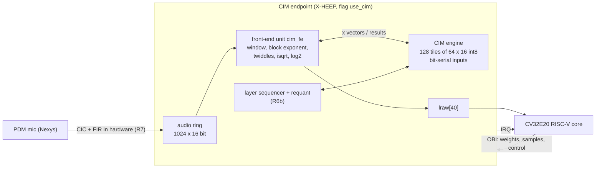

# HopCIM — Research Proposal

**Exact, model-preserving MFCC and keyword spotting on a digital compute-in-memory accelerator inside an open RISC-V microcontroller**

Master's thesis direction, NYCU · CIM × RISC-V · thesis due June 2027
Version 1.2, 2026-11-07 (first version 2026-10-27) · Living document. Design and result details are in the linked specifications.

Evidence labels used throughout:

| Label | Meaning |
|---|---|
| **[M]** | Measured in this project (simulation or board) |
| **[P]** | Published by others |
| **[E]** | Estimate or model, not yet measured |
| **[H]** | Hypothesis |

---

## Contents

1. [Executive summary](#1-executive-summary)
2. [Background](#2-background)
3. [The bottleneck (measured)](#3-the-bottleneck-measured)
4. [Related work and the gap](#4-related-work-and-the-gap)
5. [Inspirations and key insights](#5-inspirations-and-key-insights)
6. [Research questions](#6-research-questions)
7. [Hypotheses](#7-hypotheses)
8. [Approach](#8-approach)
9. [Evaluation methodology](#9-evaluation-methodology)
10. [Results so far](#10-results-so-far)
11. [Work plan and timeline](#11-work-plan-and-timeline)
12. [Risks and mitigations](#12-risks-and-mitigations)
13. [Expected contributions and novelty boundary](#13-expected-contributions-and-novelty-boundary)
14. [Limitations](#14-limitations)
15. [Where we are now and what comes next](#15-where-we-are-now-and-what-comes-next)
16. [References](#16-references)
- [Appendix A — Repository map](#appendix-a--repository-map)
- [Appendix B — How to reproduce](#appendix-b--how-to-reproduce)
- [Appendix C — Engineering lessons](#appendix-c--engineering-lessons)

---

## 1. Executive summary

**Problem.** Always-on keyword spotting (KWS) on a microcontroller has two parts:
- a signal-processing front-end, the MFCC: FFT, magnitude, mel filterbank, log and DCT;
- a small neural network, here the MLPerf Tiny DS-CNN.

A compute-in-memory (CIM) accelerator makes the network's multiply-accumulates (MACs) cheap. The MFCC then becomes the bottleneck: a census model of streaming hops on our RISC-V MCU gave 78–92 % of the remaining per-hop work [M+E]. Measured later, this holds only once the network's data movement has also left the CPU: with the CPU orchestrating the network, the front-end is about 1 % of the cycles [M] (H1, §7).

Existing CIM KWS chips avoid this in one of two ways:
- they leave the MFCC outside the CIM;
- they replace it with a learned, model-specific front-end and retrain the network.

No work we found computes the **standard** MFCC on a CIM while keeping a **pretrained model unchanged**.

**Idea.** A *digital, bit-serial* CIM computes exact multi-bit integer dot products, with inputs of up to 24 bits at a cost proportional to the bit width. That is enough to run the standard MFCC itself:
- a four-step FFT (512 = 16 × 32) using small int8 DFT matrices and a per-frame block exponent;
- the mel filterbank and the DCT as int8 weight tiles;
- a small hardware epilogue for the non-matrix steps: window, twiddles, square root, log.

The front-end and the network then share one CIM. Existing MFCC-trained models deploy without retraining, and the CPU of the MCU can sleep.

**Evidence so far** (all on an open X-HEEP RISC-V SoC; simulation and a Nexys A7 FPGA board, which agree cycle for cycle):

| Question | Result |
|---|---|
| Is it new? | Novelty gate passed with a narrowed claim: FFT-on-CIM and mel/DCT-on-memory exist; the complete unchanged MFCC on a CIM feeding an unchanged model does not [P] |
| Is the model preserved? | Unchanged MLPerf Tiny int8 DS-CNN: **91.78 %** with our integer CIM-MFCC vs **91.66 %** with float MFCC (McNemar p = 0.44) [M] |
| Does it map exactly? | 8 CIM tiles, 54 passes per frame (+2 for the DCT); identical to the golden model on **all 239,610 frames** of the test set [M] |
| Does it work in hardware? | CIM engine, X-HEEP endpoint and a hardware MFCC front-end, bit-exact on the board [M] |
| Does it pay? | Offloading only the front-end's MACs: **1.1×** fewer CPU cycles. Moving the whole front-end into hardware: **21.8×** fewer CPU-active cycles (6,710 vs 146,364 per frame) [M] |
| Is reusing the CIM cheaper than a dedicated front-end? | **No** (H4 not supported). A dedicated radix-2 MFCC unit (B3), equally accurate, costs the same logic (1,447 vs 1,530 LUT, 8 vs 7 DSP) and needs no CIM capacity [M] |
| Does the network run on the same CIM? | Yes, bit-exact with TFLite's reference kernels (91.80 %), all 7,501 passes. CPU-orchestrated it needs 11.8–13.0 M cycles per inference (depending on layout and build), three quarters of it depthwise data movement. **With the hardware layer sequencer (R6b) it takes 85,420 cycles (5.69 ms at 15 MHz) with the CPU asleep; 459 CPU-active cycles per streaming decision** [M, board = simulation] |

**Since then:**
- The per-window feature step is in hardware too (R5b, `WINDOW_PATH.md`). The MLPerf Tiny
  preprocessing normalises each 1-s window by its peak, which changes at 11.6 % of hops.
  Streaming decisions are bit-exact on the board, and the CPU does 600 cycles of work per decision
  beyond copying the new samples.
- The live microphone path (R7, `LIVE_AUDIO.md`) runs on the board. The on-board microphone,
  decimator, front-end, window path and network give one decision per 20 ms hop with the CPU
  asleep. The CPU does 263 cycles per decision; at 15.36 MHz that is 0.09 % of the hop. On real
  microphone audio, the board's logits equal the golden model's. The lowest real-time clock,
  5.12 MHz, runs on the board with no overrun. In a scripted test with one speaker, 48 of 50 spoken
  keywords were correct at a decision every 20 ms and 47 of 50 at 40 ms (`LIVE_AUDIO.md` §9). The
  end-to-end comparison is in `EVALUATION.md`.

**Later on 2026-11-07:**
- The results do not depend on a fast macro: the lowest real-time clock stays at 5.12 MHz for every assumption with an issue interval of at most 9 cycles, and a faster
  macro gains about 0.1 %, because requantisation and gathering are what bind (`TIMING_SENSITIVITY.md`).
- ZigZag-IMC itself agrees with the transcribed energy equations where the array shape matches, ratio 1.000, and within 3 % at the measured activity (`ENERGY_ESTIMATE.md` §11).
- Assertions, coverage, mutation and extreme-input tests found no RTL defect (`VERIFICATION.md`).
- An 8.38-h run in the room found false reports with the current rule in the evening, while the student was in the room, 25 per hour over 1.38 h, and none in the 7 h of the night (`SAME_AUDIO.md` §6). Firmware rules can reduce them; none is chosen yet.

**What remains** (order and reasons in §15.2):
1. the manual IEEE Xplore search, and repositioning the thesis claim after the H4 result (§13a);
2. the spoken same-audio runs, with several speakers: whether 80 ms works on real speech, and which confirmation rule to use;
3. checking the macro assumptions against the papers;
4. the scoped ASIC flow for the digital logic, which needs permission to install.

The plan (§11) completes these by April 2027 and leaves May–June for writing.

---

## 2. Background

### 2.1 Always-on keyword spotting on microcontrollers

KWS listens continuously for a small vocabulary ("yes", "no", "up", "down", …) on a battery-powered device. The standard benchmark setting is MLPerf Tiny KWS [P: Banbury et al. 2021]:

| Item | Setting |
|---|---|
| Dataset | Google Speech Commands v2 [P: Warden 2018], 12 classes (10 words, silence, unknown) |
| Window | 1 s of 16 kHz audio |
| Features | 49 frames of 10 MFCCs: 30 ms frames (480 samples), 20 ms hop (320 samples), 40 mel bands over 20–4000 Hz |
| Model | DS-CNN [P: Zhang et al., "Hello Edge"]: a 10 × 4 convolution with stride 2, then 4 depthwise-separable blocks (3 × 3 depthwise + 1 × 1 pointwise, 64 channels), average pooling and a 12-way classifier |

The int8 reference model has **22,016 weights (21.5 KiB)** and needs **2.66 M MACs per inference** [M: read from `kws_ref_model.tflite`]. Its published accuracy is about 92 %. In always-on use, a new 20 ms hop arrives continuously, so the front-end must process 50 frames per second.

### 2.2 The MFCC front-end

For each frame:
1. multiply by a Hann window;
2. take a 512-point FFT;
3. take the magnitude |X| of bins 0..256;
4. apply a 40-band triangular mel filterbank;
5. take the natural log;
6. take a DCT-II and keep the first 10 coefficients.

The MLPerf Tiny pipeline also normalises each clip by its peak sample value. Steps 2, 4 and 6 are linear maps, i.e. matrix–vector products; steps 1, 3 and 5 are element-wise nonlinear or scaling operations.

### 2.3 Compute-in-memory: analog and digital

CIM performs MACs inside or next to the weight memory, which avoids moving weights.

| Type | How it computes | Precision |
|---|---|---|
| **Analog** (ReRAM, FeFET, eDRAM, charge-domain SRAM) | Sums currents or charges, then digitises with ADCs | Limited by ADC precision (typically a few bits) |
| **Digital** SRAM CIM [P: e.g. Chih et al., ISSCC 2021] | Bit-serial inputs against stored weights, exact adder trees | Exact integers; cost scales with input width (b cycles for b-bit inputs) |

This difference matters here. Analog CIMs (limited by ADC precision) and binary CIMs (1-bit operands, binarised outputs) cannot compute a 16-bit FFT exactly. The KWS designs built on them learn a front-end that suits their arithmetic instead; the papers cite lower complexity and end-to-end training as reasons. A digital bit-serial CIM can compute the standard MFCC exactly, at a known cycle cost.

### 2.4 CIM inside RISC-V microcontrollers

The platform is **X-HEEP** [P: Machetti et al.], an open, configurable RISC-V MCU:
- CV32E20 core;
- 4 × 32 KiB SRAM;
- OBI bus with ports for external accelerators;
- DMA;
- PDM microphone interface;
- an FPGA flow for the Digilent Nexys A7-100T, whose onboard ADMP421 microphone allows a live demo.

The CIM is added as an X-HEEP endpoint. On the FPGA it is an *emulation*:
- weights in block RAM;
- 128 DSP multipliers;
- the cycle behaviour of a 64-row bit-serial digital CIM macro.

Results, and the cycle counts seen by the SoC, are exact. Energy and area of a real CIM are not emulated (see §9.5).

---

## 3. The bottleneck (measured)

### 3.1 CPU costs on X-HEEP

Measured with `census_microbench` on the board, cycle-identical to simulation [M]:

| Kernel | Cycles |
|---|---:|
| int8 MAC (conv / pointwise / depthwise) | 12.6 / 11.5 / 18.8 per MAC |
| Requantisation (multiply-shift-clamp / TFLM-exact) | 20 / 35 per output |
| MMIO write / read | 8 / 9 |
| **512-point FFT (Q15)** | **145,142 per frame** |
| Power + mel + log + DCT | 15,632 per frame |
| **CPU-only MFCC front-end** | **160,774 per frame** |

At 15 MHz a 20 ms hop is 300,000 cycles, so the CPU-only front-end alone uses 54 % of the CPU.

### 3.2 Per-hop composition once a CIM runs the network

A model built from these measured constants and a modelled digital CIM [M constants + E model] (`research_discovery/20261026_application_driven/analysis/post_cim_census.py`) gives the following per-hop numbers:

| Scenario | Wall cycles/hop | CPU-active cycles/hop | Front-end share |
|---|---:|---:|---:|
| S0: CPU only (streaming DS-CNN + MFCC) | 859,689 | 859,689 | 18.7 % |
| S1: CIM runs the MVMs; CPU requantisation and MFCC | 205,092 | 197,752 | **78.4 %** |
| S2: S1 + hardware epilogue | 175,584 | 168,952 | **91.6 %** |
| S3: S2 + lean driver + real-input FFT | 104,088 | 97,456 | **91.7 %** |
| S4: front-end also on the CIM (learned filterbank) | 9,568 | 2,268 | 6.8 % |
| S5: S4 + autonomous hop program | 7,800 | 500 | 8.4 % |

**Conclusion.** Once a CIM accelerates the network, almost all of the remaining CPU work is the front-end. The biggest lever is moving the front-end off the CPU (S3 → S4: about 43× in CPU-active cycles). The exact-MFCC variant of S5 was modelled at about 11.8k cycles/hop (real time at 0.59 MHz) with about 500 CPU cycles [E].

### 3.3 Amdahl's law in practice: offloading only the MACs is not enough

We built the exact integer front-end with every matrix step on the CIM, orchestrated by the CPU (R4b), and measured it per frame. Board and simulation agree [M]:

| Stage | Cycles/frame | Share |
|---|---:|---:|
| Window + block exponent (CPU) | 16,001 | 10.9 % |
| FFT step 1: 32 CIM passes, CPU moves the data | 18,681 | 12.8 % |
| Twiddles (CPU) | 21,726 | 14.8 % |
| FFT step 3: 16 CIM passes | 12,202 | 8.3 % |
| Magnitude: 128 integer square roots (CPU) | 70,881 | 48.4 % |
| Mel: 4 CIM passes | 1,801 | 1.2 % |
| Log2 (CPU) | 2,966 | 2.0 % |
| Normalisation + DCT + requantisation | 2,104 | 1.4 % |
| **Total** | **146,364** | |

That is only **1.1×** better than the CPU-only front-end (160,774). The engine itself computes for 932 cycles per frame. The remaining time is:
- the CPU epilogue (window, twiddles, magnitude): 74 %;
- CPU-driven data movement: most of the rest.

**This measured result is the core motivation for HopCIM.** The front-end must move into hardware as a whole, epilogue and data movement included. Just using the CIM for its MACs is not enough.

---

## 4. Related work and the gap

### 4.1 Keyword spotting on CIM

Papers were read in full unless marked *(abstract only)*.

| Work | CIM | Front-end | Takeaway for HopCIM |
|---|---|---|---|
| CIMR-V (Guo, Chang et al., ISCAS 2024; NYCU + ITRI) | 1-bit SRAM CIM, Ibex RISC-V host | Raw audio → binary 1-D convolution on the CIM | RISC-V + CIM for KWS is taken; the front-end is learned |
| PSCNN (Kuo & Chang, 2022; NYCU) | Binary/ternary SRAM CIM, own ISA | Raw audio → binary CNN | Learned front-end; autonomous controller |
| Chiang, Chang, Jou (IEEE TVLSI 2022; NYCU) | In-SRAM computing + on-chip learning | 8-bit raw audio → binarised sinc filterbank, "compared to conventional MFCC" (front-end checked in the arXiv full text) | Learned front-end |
| RV-Flash (Kang et al., ASP-DAC 2025) | Binary eFlash CIM + RISC-V + FP16 vector unit | Not addressed | CIM alone gives −7.7 to −11.4 % latency because the non-MVM operations dominate; supports our Amdahl argument |
| Multi-stationary (D. Kim & K. J. Lee, JSTS 2026) | eDRAM analog CIM | Raw-audio sinc convolution | Learned front-end; depthwise tricks |
| Song et al. (Interspeech 2022) | Algorithm | Knowledge-distilled "IMC encoder" replacing MFCC | Learned front-end; cites MFCC as 97.8 % of CPU time in their setting |
| FeFET streaming (Luo, Vanderhaegen, Rybakov, Yu, IEEE TETC 2024) | FeFET analog CIM | **External** MFCC module | Streaming CIM is taken |
| Multibit ReRAM (D. Kim et al., IEEE TCAS-I 2026) | ReRAM analog CIM | **External** MFCC | — |
| **Jia et al. (ISCAS 2022, Fudan)** | Digital computing-on-memory-boundary macros | 256-point FFT in a **dedicated serial R2²SDF block**; log by CORDIC, moved **before** the mel filter; mel + DCT fused into one ternary 129 × 40 matrix on the macro; model **retrained** (90.54 %, 10 keywords) | Closest digital work: mel/DCT on a memory macro is taken, but the FFT is not on the macro and the MFCC is changed |
| **Wang et al. (Science Advances 2025, USC)** | Analog memristor SoC with RISC-V | **Direct 128-point DFT** on the crossbar; magnitude on a PC; no mel, log or DCT; AudioMNIST 94.72 % | Closest system: spectral front-end + CNN on one CIM SoC is taken (analog, not MFCC) |
| AM-CIM (IEEE TCAS-I 2025) *(abstract only)* | Multilevel analog-memory near-sensor CIM | Simplified mel-energy features, GRU | Not the standard MFCC |
| Analogue speech recognition (Nature 2025) *(abstract only)* | Two in-materia analog computing systems | Analog in-materia feature extraction and classification (TI-46, GSC) | Different paradigm: analog physical computing |

### 4.2 FFT and DFT on CIM

FFT-on-CIM is established, so it is **not** a claim of this work:
- SRAM: CSIFA (ASAP 2024); small-point FFT on SRAM-CIM (Microelectronics J. 2026);
- hybrid in-memory: SHIFFT (ISVLSI 2024);
- RRAM: ReFFT (TCAD 2025);
- PIM: FourierPIM (2023);
- analog: analog FFT (arXiv 2409.19071);
- memristor DFT, including the early dot-product engine work (ICRC 2016).

None of these builds a KWS front-end or feeds an unchanged model.

### 4.3 Dedicated MFCC hardware

Dedicated always-on front-ends exist and set the hardware bar. An example is the 0.61 µW KWS ASIC with a real-point serial-FFT MFCC (IEEE JSSC 2023). The same holds for Jia et al.'s serial FFT block. A dedicated FFT/MFCC block is therefore **the required hardware baseline** (B3, §9.2): HopCIM must show what reusing the CIM saves, or honestly report what it costs.

### 4.4 The FFT as small matrix products

The four-step ("six-step") FFT factors an N = N1·N2 DFT into N2 DFTs of size N1, a twiddle multiplication, and N1 DFTs of size N2 [P: Bailey 1990]. GPU libraries use the same factoring to map FFTs onto tensor-core matrix units [P: tcFFT, arXiv 2104.11471]. HopCIM applies it to CIM tiles.

### 4.5 The gap

From the novelty assessment (`research_discovery/20261026_application_driven/NOVELTY_ASSESSMENT.md`) and the gate (`kws_gate/GATE_RESULTS.md`):

| Pillar | Status |
|---|---|
| RISC-V host + CIM for KWS | Taken (CIMR-V, RV-Flash) |
| Learned or raw-audio front-end on the CIM | Taken (4+ works) |
| Streaming CIM; autonomous controller; depthwise tricks; layer fusion | Taken |
| FFT on CIM; mel/DCT on a memory macro; spectral front-end + CNN on one CIM SoC | Taken (FFT-on-CIM papers; Jia et al.; Wang et al.) |
| **The standard MFCC (FFT + magnitude + mel + log + DCT) on a CIM, feeding an unchanged pretrained model** | **Open** |
| Exact digital multi-bit bit-serial CIM for KWS | Open |
| CPU involvement and real time measured inside a general-purpose MCU on hardware | Open |
| Equal-platform comparison of front-end strategies (CPU / dedicated / CIM) | Open |

**Claimable sentence** (narrowed after the gate):

> The complete, unchanged MFCC front-end and the KWS network on one **digital** bit-serial CIM, with **no retraining**, inside a RISC-V MCU, with measured real-time behaviour.

**Literature-search coverage:**
- OpenAlex: 19 query families, 1,444 works screened, 80 reviewed by hand.
- arXiv: 8 query families, 107 entries.
- IEEE Xplore: refuses scripted requests. **The manual Xplore search is still open** (§15).

---

## 5. Inspirations and key insights

1. **Amdahl after the accelerator.** The census (§3.2) showed that a CIM moves the bottleneck from the network to the front-end. RV-Flash reports the same effect for in-network operations. HopCIM attacks the front-end itself.
2. **Why others changed the model.** CIMR-V, PSCNN, Chiang et al., the multi-stationary chip and Song et al. moved the front-end into the CIM by *replacing* the MFCC with a learned convolution. The papers cite lower complexity and end-to-end training; it also suits their arithmetic, which cannot compute a 16-bit FFT exactly. A **digital bit-serial** CIM removes this constraint: inputs of up to 24 bits cost proportionally more cycles but stay exact. The standard MFCC can therefore be kept, and with it every existing MFCC-trained model.
3. **The MFCC is mostly matrices.** The DFT, the mel filterbank and the DCT are linear maps. Jia et al. already fused mel and DCT into one matrix on a memory macro. The four-step FFT (Bailey; tcFFT) turns a 512-point FFT into small DFT matrices that fit 64-row CIM tiles.
4. **Block floating point fits the bit-serial cost model.** A per-frame block exponent normalises each frame to about 16 bits. The int8 DFT tiles then see 17-bit inputs at a cost of 17 cycles per pass, with a fidelity of about 0.1 dB mean and ≤ 0.5 dB p99 log-mel error from 0 to −30 dBFS [M: fidelity screen on synthetic speech-like frames].
5. **Exploit the structure exactly.**
   - The 16-point DFT of real data is conjugate-symmetric, so each pass yields 16 useful real outputs.
   - The mel filterbank only uses bins 1–127, so half the FFT outputs are never needed.
   - The int16 DCT splits into two int8 tiles.

   All three are exact. Together they cut the work to 54 passes per frame.
6. **Share one CIM.** The CIM is idle most of each 20 ms hop. The front-end needs about 932 engine cycles per frame out of a 300k-cycle budget, so the front-end and the network can time-share one macro instead of adding a dedicated FFT block. Whether this saves hardware is exactly what baseline B3 must show.
7. **Preserve the model; measure what matters.** Keeping the published model fixed turns accuracy into a fidelity question, gated on the full test set. Without real silicon, the honest metrics are cycles, CPU-active time, accuracy and FPGA resources (§9.5).

---

## 6. Research questions

- **RQ1 — Fidelity.** Can the complete standard MFCC (FFT, magnitude, mel, log, DCT) be computed with exact integer arithmetic on a digital bit-serial CIM, such that a pretrained, unchanged KWS model keeps its accuracy?
- **RQ2 — Bottleneck.** In an MCU with a CIM, where does the per-hop time go? How much CPU work disappears when only the front-end's MACs move to the CIM, versus when the whole front-end moves into CIM-attached hardware?
- **RQ3 — Cost.** What does reusing the CIM for the front-end cost (CIM capacity, added logic, cycles), compared with a dedicated FFT/MFCC block on the same platform? When does reuse pay?
- **RQ4 — End-to-end.** Can the full always-on KWS pipeline (front-end + DS-CNN) run on one CIM inside a RISC-V MCU in real time, with the CPU mostly asleep and the same accuracy?

---

## 7. Hypotheses

Thresholds are frozen before the final runs, as was done for gate 2 (`kws_gate/GATE2_MANIFEST.md`). The hypotheses and their falsification lines below stand as written on 2026-10-27; only the Status column changes. H1 and H3 did not come out as written, and that is recorded here rather than reworded.

| ID | Hypothesis [H] | Falsified if | Status |
|---|---|---|---|
| **H1** (bottleneck) | With the network on the CIM, the CPU-side front-end is ≥ 70 % of per-hop CPU cycles | < 50 %, measured on the board | **Holds only with the network's data movement also off the CPU** [M]. As first built, with the CPU orchestrating the network (configuration B, `EVALUATION.md`), the front-end is 146,364 of 13.17 M cycles: **1.1 %, falsified in that configuration**. With the layer sequencer and a CPU front-end it is 91–98 % (146,364 against 459 for the network and 2,120–14k for the window path; composed from measured parts, not one run). The census figure of 78–92 % came from a model of streaming hops of about 205k cycles, far less network work than the full-window inference built here |
| **H2** (fidelity) | The integer CIM-MFCC keeps the unchanged int8 DS-CNN within 0.3 pp of float MFCC on the GSC test set | Δ < −0.3 pp | **Passed:** 91.78 % vs 91.66 % (Δ +0.12 pp, p = 0.44); bit-exact in hardware |
| **H3** (CPU-light) | Per-hop CPU-active cycles fall ≥ 20× against the CPU-orchestrated CIM baseline, and the real-time clock requirement f_min falls below 1 MHz | < 5×, or f_min ≥ 2 MHz | **Not supported as written** [M]. CPU half **far exceeded**: 13.17 M → 263 CPU-active cycles per hop, about 50,000× (≥ 20× required). f_min half **falsified**: measured 5.12 MHz, against a target below 1 MHz and a failure line of 2 MHz. A hop without the network needs about 7.8k cycles (≈ 0.4 MHz), but a decision hop runs the whole network inside one hop, 97.7k cycles at worst, and the microphone needs an integer multiple of 1.024 MHz. Running the network every k hops does not lower this (`LIVE_AUDIO.md` §9) A faster macro does not lower the clock; requantisation and gathering bind it (`TIMING_SENSITIVITY.md`). 2026-11-08: the baseline S (a second requantisation lane, `BASELINE_S.md`) lowers f_min to 4.096 MHz [M, RTL and board], still above the 2-MHz line, so the f_min half stays falsified. |
| **H4** (cost) | The logic added to run the front-end on the CIM costs no more (LUT + DSP + BRAM) than a dedicated FFT/MFCC block on the same FPGA | It costs more, with no capacity or flexibility gain to offset it | **Not supported.** At matched design style, B3 costs 1,447 LUT, 8 DSP, 2 RAMB18; `cim_fe` costs 1,530 LUT, 7 DSP, 4 RAMB18, plus 6 KiB of CIM. Both pass the accuracy gate. Details: `B3_BASELINE.md` |
| **H5** (end-to-end) | Front-end + DS-CNN on one CIM gives the same accuracy as the TFLite int8 reference (bit-exact), in real time at 15 MHz | Accuracy differs, or real time is missed | Accuracy: **met** (bit-exact with the reference kernels, 91.80 %). Real time: **met** on the board. The network takes 5.69 ms per inference at 15 MHz with the CPU asleep (`SEQUENCER.md`); CPU-orchestrated it was 11.8–13.0 M cycles. With the window path in hardware (R5b), a streaming decision every 20 ms hop takes 6.5–6.8 ms of hardware time and 600 CPU-active cycles beyond copying the samples (`WINDOW_PATH.md`) |
| H6 (optional) | A shared CIM-MFCC beats per-model learned CIM front-ends once *k* always-on models share it | — | Optional extension |

---

## 8. Approach

### 8.1 Design principles

- **Exactness first.** The Python golden model `hopcim/model/mfcc_int.py` is the specification. Every hardware or firmware step is checked bit-exactly against it.
- **Model preservation.** The MLPerf Tiny int8 DS-CNN is never retrained.
- **Digital only.** Everything is RTL or firmware, evaluated in Verilator and on the FPGA.
- **Simulation equals board.** The simulated SoC uses the same interconnect topology as the FPGA, so cycle counts agree exactly.

### 8.2 The integer CIM-MFCC (golden model)

Full specification: `MFCC_INT_SPEC.md`.

| # | Step | Where | Arithmetic |
|---|---|---|---|
| 1 | Hann window | epilogue | int16 × Q15 |
| 2 | Block exponent | epilogue | shift so that the peak lies in [2¹⁴, 2¹⁵), with round-half-up |
| 3 | FFT step 1: 32 × 16-point DFT | **CIM** | int8 DFT tile, `>> 11` |
| 4 | Twiddles | epilogue | Q14 complex multiply, `>> 14` |
| 5 | FFT step 3: 16 × 32-point DFT | **CIM** | int8 DFT tile, `>> 9` |
| 6 | Magnitude | epilogue | exact integer `isqrt(re² + im²)` |
| 7 | Mel (40 bands) | **CIM** | int8 mel tiles |
| 8 | Log2 | epilogue | leading one + 64-entry table (Q8); frame exponent and constant scales folded in (Q16) |
| 9 | Normalisation | per window | subtract log2(window max) (16-step integer log2), multiply by ln 2, floor at ln 10⁻⁶ |
| 10 | DCT (10 of 40) | **CIM** | int16 coefficients as two int8 tiles |
| 11 | Requantisation | epilogue | `trunc(acc · M / 2⁴⁴ + 83)`, saturated to int8 — the model's input quantisation |

### 8.3 Mapping onto the CIM

Tile layout: `hopcim/model/cim_map.py`.

| Step | Tiles (64 × 16 int8) | Passes/frame | Input width b | Engine cycles (D = max(8, b)) |
|---|---:|---:|---:|---:|
| FFT step 1 | 1 | 32 | 17 | 544 |
| FFT step 3 | 1 | 16 | 17 | 272 |
| Mel | 4 (of 15 possible; the others are all zero) | 4 | 22 | 88 |
| DCT | 2 | 2 | 14 | 28 |
| **Total** | **8 (8 KiB)** | **54** | | **932** |

The exactness rules, each checked against the golden model:
- **Mirrored step-1 outputs are negated *before* round-half-up.** Negating after rounding is wrong on ties: 42 mismatching lraw values in 2,940 frames. Both the Python and the RTL tests catch it.
- **Step 3 computes only bins 0–127**, because the mel weights of all higher bins are zero.
- **Input widths are worst-case bounds,** not observed ranges, so the hardware is exact for any input.

### 8.4 The CIM engine model

Specification: `ENGINE_SPEC.md`.

- 128 resident tiles since R6 (64 before), each 64 rows × 16 int8 columns, 1 KiB; the design uses 69, one active per pass. How a real chip would organise them is an open assumption (`ENERGY_ESTIMATE.md` §6). Inputs are 1–24 bits wide; accumulators are 48 bits wide.
- Timing contract: a pass accepted at cycle t0 delivers its results at t0 + D + 5, and the next pass may start at t0 + D, with D = max(8, b). This models a bit-serial 64-row digital macro in which one input bit-plane takes one cycle.
- FPGA emulation: 32 BRAM banks plus 128 DSPs compute 8 rows × 16 columns per cycle. Results are bit-exact and the cycles seen by the SoC are exactly those of the modelled macro. FPGA power and LUTs are not CIM energy or area.

### 8.5 System architecture



| Block | Status | Cost (Vivado OOC, xc7a100t, 15 MHz) |
|---|---|---|
| `cim_engine` (R1, 128 tiles since R6) | Done, verified | 2,018 LUT, 1,648 FF, 32 RAMB36, 128 DSP |
| `cim_endpoint` with CPU port (R2) | Done | Complete endpoint in the last row |
| X-HEEP integration (R3): FuseSoC flag `use_cim`, direct CPU-port tap, IRQ line 3 | Done, on board | — |
| `cim_fe` hardware front-end, frame path (R5a) | Done, on board | 1,530 LUT, 345 FF, 4 RAMB18, 7 DSP |
| Window path in hardware (R5b): window-max tracking, lraw ring, DCT + requant | Done, on board | `cim_seq` with it: 2,443 LUT, 1,982 FF, 11.5 BRAM tiles, 9 DSP |
| DS-CNN on the CIM: layer sequencer + requantisation epilogue (R6b) | Done, on board | Included in `cim_seq` above |
| Live audio path (R7): PDM microphone, CIC + FIR + DC blocker at exactly 16 kHz, hop controller | Done, on board | `cim_audio` 1,026 LUT, 850 FF, 1 DSP. **Complete endpoint with `cim_fe`: 7,635 LUT, 5,819 FF, 46 BRAM tiles, 145 DSP, +46.9 ns** |

### 8.6 The network on the same CIM: the plan of 2026-10-27

Kept as written when the network was still planned. **Outcome:** 128 tiles; every tile and pass count below confirmed exactly [M]; 85,420 cycles per inference with the sequencer (`SEQUENCER.md`).

Layer shapes are taken from the TFLite model [M].

| Layer | Shape | MACs | Tiles (64 × 16) | Passes/inference |
|---|---|---:|---:|---:|
| conv 10 × 4, stride 2 | 49 × 10 × 1 → 25 × 5 × 64 | 320,000 | 4 | 500 |
| 4 × depthwise 3 × 3 (block-diagonal, 7 channels per tile) | 25 × 5 × 64 | 4 × 72,000 | 4 × 10 | 4 × 1,250 |
| 4 × pointwise 1 × 1 | 64 → 64 | 4 × 512,000 | 4 × 4 | 4 × 500 |
| fully connected | 64 → 12 | 768 | 1 | 1 |
| **Total** | | **2,656,768** | **61** | **7,501** |

Consequences for the design:
- **Capacity.** The network (61 tiles) plus the front-end (8 tiles) needs 69 tiles, more than the current 64. Options:
  - raise the CIM to 128 tiles (+32 RAMB18; the SoC uses 54.5 of 135 BRAM tiles);
  - run the depthwise layers on a small vector unit.

  The decision is part of Phase 2.
- **Time.** At b = 8 the engine needs at least 60k cycles per inference. Moving inputs at 1 value per cycle would add about 460k cycles. The sequencer therefore needs gathers of 4–8 values per cycle to allow one exact inference every hop or every few hops [E]. Streaming per-layer computation [P: Rybakov et al.] is an optional optimisation.
- **Requantisation.** About 72k outputs per inference need TFLite-exact requantisation (per-channel multiplier, shift and zero point). On the CPU that costs 20–35 cycles each, so it needs a hardware epilogue.
- **Exactness.** An integer reference of the int8 network is first verified against TFLite logits on the test set. The hardware then has to match that reference.

---

## 9. Evaluation methodology

### 9.1 Platform and tools (digital only)

- **Verilator 5.040:** unit tests and the full SoC.
- **Vivado 2024.1:** cost and timing; Nexys A7-100T at 15 MHz.
- **Python/TensorFlow:** golden models and accuracy.

No analog, device, SPICE or tape-out work.

### 9.2 Baselines

IDs follow the round-5 report; its B2 and B4 (software-driver and windowing variants) are not needed here.

| ID | Description | Status |
|---|---|---|
| B0 | CPU only: MFCC on the CV32E20 (census kernels), network in software | Front-end measured: 160,774 cycles/frame |
| B1 | CIM for MACs only; CPU does the epilogue and data movement (R4b) | Measured: 146,364 cycles/frame |
| **B3** | **Dedicated FFT/MFCC block** on the same FPGA and bus, same feature contract, accuracy gated the same way | **To build (Phase 1)** |
| HopCIM-FE | Hardware front-end on the CIM (R5a, then R5b) | R5a measured: 6,710 CPU-active cycles, 7,485 latency |
| HopCIM | Front-end + network on the CIM, CPU asleep between hops | Phases 2–3 |
| B5 (optional) | Learned raw-audio front-end on the same CIM (CIMR-V/Song style) | Optional; needs training on the GPU |

### 9.3 Metrics

| Metric | Source |
|---|---|
| Accuracy (GSC v2 test set, 4,890 clips, 12 classes); McNemar against float MFCC | Python model, bit-exact with the hardware |
| Per-hop wall cycles; CPU-active cycles; real-time clock requirement f_min | Board counters (`mcycle` plus a sleep counter, see below) |
| Detection latency | Board |
| LUT, FF, BRAM, DSP; timing slack | Vivado (out of context and in the full SoC) |
| CIM capacity used (tiles/KiB); bytes moved over the bus | Mapping tools, firmware |
| Optional: FAR/FRR on long concatenated streams | Streaming runs |

**Measurement caveat.** On the FPGA the X-HEEP clock gate is a pass-through, so `mcycle` keeps counting during WFI sleep. True CPU-active time therefore uses `mcountinhibit` around WFI plus the endpoint's `CYCLES` register, validated on the board (§15.1).

### 9.4 Verification methodology

- **Golden models.** `mfcc_int.py` defines the front-end; `cim_map.py` defines its tile mapping. The mapping is checked against the golden model on all 239,610 test frames.
- **Unit testbenches.** These check the RTL against those models, including the timing contract. Mutation tests confirm that the tests detect the subtle rounding rule.
- **SoC firmware.** Firmware compares every frame against generated test vectors; the same binaries run on the board.
- **Simulation and board must agree cycle for cycle** (achieved; see Appendix C).

### 9.5 What is not claimed

- No measured CIM energy or area. The CIM is emulated on an FPGA; FPGA power is not CIM power.
- Comparisons with analog CIM chips use cycles, CPU time, accuracy and resources, not TOPS/W.
- **[E]** A model-based estimate at 28 nm, from exact activity and published tools, is reported as an
  estimate (`ENERGY_ESTIMATE.md`): about 110, 75 and 58 µW at a decision every 20, 40 and 80 ms. It
  supports comparisons between design options. It is not an energy advantage over any chip.
- Optional: post-synthesis digital power from an open ASIC flow, labelled as an estimate. It would
  replace the coarsest part of that estimate.

---

## 10. Results so far

### 10.1 Gates (2026-10-26)

| Gate | Rule | Result |
|---|---|---|
| Step 1: novelty | Stop if any work runs the full standard MFCC, including the FFT, on a CIM | **Passed with a narrowed claim** (§4.5) |
| Step 2: accuracy, first datapath | Δ ≥ −0.3 pp, unchanged int8 DS-CNN | **91.80 % vs 91.66 %** (Δ +0.14 pp; McNemar 17 vs 24, p = 0.35) |
| Board steps | CPU costs and microphone | CPU census identical to simulation; onboard mic captures speech at −47 dBFS against a −72 to −76 dBFS noise floor |

### 10.2 Integer pipeline, re-gated (R4a)

| Features | int8 model | float32 model |
|---|---:|---:|
| Float reference MFCC | 91.66 % | 91.86 % |
| **Integer CIM-MFCC (`mfcc_int.py`)** | **91.78 % (Δ +0.12)** | 91.76 % (dequantised input) |

McNemar: 18 vs 24 discordant clips, p = 0.44.

Feature agreement with the reference:
- 96.7 % of int8 features are equal, and 99.94 % are within ±1 step.
- The only large differences are 28 values (0.0012 %) where the reference's int8 cast wraps around and ours saturates.

### 10.3 Hardware results

| Item | Result [M] |
|---|---|
| Engine testbench | 2,401 passes bit-exact; 1,716 back-to-back starts at the exact interval |
| Endpoint testbench | 244 checks, 0 errors |
| Mapping self-test | 4,890 clips, 239,610 frames, 0 mismatches (lraw and features) |
| Front-end testbench (RTL) | 319 frames (6 clips + 25 synthetic corner cases, block exponents −14..15, ring wrap-around), 0 mismatches; CPU/front-end interplay checks pass |
| R4b firmware (CPU-orchestrated) | 49 frames bit-exact; 146,364 cycles/frame; 7.53 M cycles per clip |
| **R5a firmware (hardware front-end)** | **49 frames bit-exact; 6,710 CPU-active cycles/frame** (samples 4,205, readback 400, finish 2,105); front-end latency 7,485; 0.98 M cycles per clip |
| Full SoC on the FPGA | 38,850 LUT (61 %), 38,859 FF, 54.5 BRAM tiles, 136 DSP. 15 MHz domain: +16.6 ns setup, +0.222 ns hold. The only failing paths are the CDC paths of the unused SPI-slave clock |
| Board | All three apps pass, with every reported cycle count identical to Verilator |
| **R6b layer sequencer (RTL)** | Every layer output and logit bit-exact (9 × 8,000 values, 20 clips, a synthetic parameter set with shifts 0..15); 6 of 6 mutations caught |
| **R6b firmware (SoC and board)** | 60 runs bit-exact on both bitstreams; 85,420 cycles per inference (5.69 ms), CPU asleep; CPU-active 9,678 cycles with a whole window, 459 per streaming step. Board = Verilator line for line (except a fixed 4-cycle offset in the one-time setup) |
| **R6b bring-up** | The first bitstreams failed on the board while every simulation passed: Vivado 2024.1 miscompiled a signed `int` address expression. Localised by a board layer readback, proven by netlist-vs-RTL simulation, fixed by rewriting the addresses as unsigned logic (`SEQUENCER.md` §8a, reproduction in `syn/vivado_miscompile/`) |

Derived from these numbers: with R5a the front-end uses about 0.95 ms of each 20 ms hop, and the CPU about 0.45 ms of it.

---

## 11. Work plan and timeline

The plan of 2026-10-27, with what has happened since (status 2026-11-07). The thesis is due in June 2027. The current order of work is in §15.2.

| Phase | When | Work | Exit gate |
|---|---|---|---|
| 0 | Oct 2026 | Gates; R1–R5a; board | **Done** |
| **1: close the evidence gaps** | Nov 2026 | (a) Manual IEEE Xplore search (student, ~1 h)<br>(b) **B3 dedicated MFCC baseline** on the same FPGA and bus, accuracy gated<br>(c) Sleep counter + WFI/IRQ path for true CPU-active time | **Gate B:** novelty still holds; H4 answered. If B3 is clearly cheaper overall, reposition the thesis as "when reuse pays" (capacity vs logic) rather than "reuse always wins". (b), (c) done Oct 2026: H4 not supported, see §13a. **(a) still open** |
| **2: network on the CIM** | Dec 2026 – Jan 2027 | (a) Integer reference of the int8 DS-CNN, bit-exact against TFLite on all 4,890 clips<br>(b) Tile mapping and the capacity decision (64 → 128 tiles, or depthwise on a vector unit)<br>(c) CPU-orchestrated network firmware (baseline B1 for the network)<br>(d) Hardware layer sequencer + requantisation epilogue (R6) | **Gate C:** end-to-end bit-exact; accuracy identical to TFLite. (a)–(d) done early, Oct 2026: network bit-exact on the board, 5.69 ms per inference with the sequencer |
| **3: window path + streaming** | Feb 2027 | (a) R5b: window-max tracking, lraw ring, DCT + requant in hardware<br>(b) Cheaper sample input<br>(c) Per-hop schedule (inference every *k* hops)<br>(d) End-to-end per-hop CPU-active cycles and f_min | H1, H3, H5 answered. (a), (b), (d) done early, Oct 2026 (the sample input is the R7 audio path); (c) done Nov 2026 (`LIVE_AUDIO.md` §9) |
| **4: live demo** | Mar 2027 | PDM → hardware CIC/FIR → ring at exactly 16 kHz (15.36 MHz clock: VCO 960 MHz, M = 48, D = 5, O = 62.5); detection on LEDs/UART; CPU asleep; optional FAR/FRR | **Gate D:** real-time live demo. Fallback: audio replayed over UART. Done early, Oct 2026 (`LIVE_AUDIO.md`); scripted test with one speaker done 2026-11-07 (§9 there) |
| 5: evaluation | Apr 2027 | All baselines and ablations; freeze results; optional extensions (B5 learned front-end, H6 shared front-end) | Results frozen. First freeze 2026-11-07 (`freeze/RESULTS.md`) |
| 6: writing | May 2027 | Thesis; paper draft | — |
| — | Jun 2027 | Buffer; defence | — |

---

## 12. Risks and mitigations

| Risk | Likelihood | Mitigation |
|---|---|---|
| A paper already computes the standard MFCC on a CIM (not yet covered by the Xplore search) | Low–medium | Run the search now (Phase 1a). If one exists, contributions 2 and 3 (§13) and the B3 comparison remain; narrow further |
| B3 (dedicated block) is cheaper than CIM reuse | **Happened** (H4) | Report it honestly. The question becomes when reuse pays (CIM capacity vs logic, flexibility, sharing across models) — still a publishable trade-off study |
| Depthwise layers map poorly onto 64 × 16 tiles | **Resolved** | Block-diagonal mapping on a 128-tile CIM |
| The assumed macro timing or capacity does not match real silicon | Medium, was medium–high | **Swept** (`TIMING_SENSITIVITY.md`): no change for an issue interval of at most 9 cycles; above that the clock rises about linearly, and the sequencer's input hold must scale. Tile organisation in `ENERGY_ESTIMATE.md` §6. The assumptions still need checking against the papers |
| False alarms in real use | **Happened** | Measured in the room (`SAME_AUDIO.md` §6): 25 per hour in an evening, none in a 7-h night. Firmware rules reduce them at some cost in recall; to be chosen on spoken runs |
| TFLite rounding details break exactness | Medium | Build and verify the integer reference against TFLite logits first (Phase 2a) |
| Real time missed with the full network | **Resolved** | Met on the board, down to 5.12 MHz |
| Live-mic domain shift lowers demo accuracy | Medium | GSC test-set accuracy stays the primary metric. One speaker so far: 48 of 50 keywords; false alarms measured in one room (above); more speakers are planned (§15.2 step 6) |
| FPGA resources or timing | Low | Currently 67 % LUT, 61 % DSP, 61 % BRAM, +15.1 ns slack at 15.36 MHz |
| Schedule | Medium | Phases ordered by research value; Phase 4 and the options can shrink |

---

## 13. Expected contributions and novelty boundary

**Contributions:**
1. **An exact integer formulation of the standard MFCC for a digital bit-serial CIM** that preserves a pretrained model's accuracy without retraining. It comprises:
   - the four-step FFT with a per-frame block exponent;
   - int8 DFT and mel tiles, and the int16 DCT as two int8 tiles;
   - Q8/Q16 log-domain bookkeeping;
   - exact mapping rules (conjugate symmetry, band-limited bins, rounding on ties).
2. **Measured evidence of Amdahl's law for CIM front-ends in an MCU.** Offloading only the MACs gives 1.1×; moving the whole front-end gives about 22× fewer CPU-active cycles. Both are measured on a board.
3. **An open X-HEEP CIM endpoint with a hardware MFCC front-end and a layer sequencer** that runs the int8 DS-CNN without the CPU, bit-exact against the golden models and cycle-identical between simulation and FPGA.
4. **End-to-end CPU-light KWS on one digital CIM**, with an equal-platform comparison against CPU-only and dedicated front-ends. Measured on the board: live microphone to keyword, 263 CPU-active cycles per 20 ms decision, real time down to 5.12 MHz (`EVALUATION.md`).

**Not claimed:**
- FFT-on-CIM;
- mel/DCT on a memory macro;
- streaming CIM;
- learned front-ends;
- autonomous CIM controllers;
- energy advantages.

**Positioning.** The analog and binary CIM line (including the NYCU works CIMR-V, PSCNN and Chiang et al.) moved the front-end into the network as a learned layer. This lowers complexity and suits their arithmetic. HopCIM is the complementary digital, multi-bit path: it keeps the standard front-end and the existing models. Neither approach is presented as wrong; the evaluation quantifies the trade-off.

### 13a. After the B3 result (2026-10-27)

A dedicated MFCC unit is as cheap as the CIM front-end's epilogue unit, so "reusing the CIM saves
hardware" is not a claim this work can make. What the evidence still supports:
- **Moving the whole front-end into hardware is what makes the MCU CPU-light (C2).** With only
  the MACs moved, the gain is 1.1×; either hardware front-end gives about 22×. The same holds
  for the network: with the CPU orchestrating it, data movement and requantisation dominate.
- **The exact, model-preserving pipeline (C1, C4).** Standard MFCC and an unchanged int8 DS-CNN,
  bit-exact with TFLite's reference kernels, on one digital CIM inside a RISC-V MCU, measured on a board.
- **The design-space evaluation.** CPU, CIM-reuse and dedicated front-ends compared on one
  platform, with honest costs. The same question applies to the network: running it every 2 or 4 hops
  saves 50–75 % of the CIM passes for 18 LUT (`LIVE_AUDIO.md` §9), and exact activation reuse across
  windows was evaluated in software against that baseline, and not built (`REUSE_EVALUATION.md`).
- **The sweep of macro timing agrees too** (`TIMING_SENSITIVITY.md`): a macro 9 times faster changes the network's cycles by 0.14 %. What binds is the requantisation and the gathering of inputs, which is
  what the sequencer moved off the CPU.
- **[E] The energy estimate agrees with this repositioning** (`ENERGY_ESTIMATE.md`). The front-end is
  about 1 % of the power either way, and the two front-ends differ by under 4 % of the total. With the
  measured activity, requantisation and the activation memory cost more than the CIM array itself. These
  shares depend on the macro style.

Suggested repositioning, for discussion with the advisor: a CPU-light, exact, always-on KWS MCU
with a digital CIM, and **what has to move into hardware**. The CIM MFCC is one evaluated design
option, not the headline. The remaining research weight shifts to the network side: the layer
sequencer, depthwise data movement and requantisation on the CIM.

---

## 14. Limitations

- The CIM is emulated on an FPGA: cycle-faithful at the SoC level, with no silicon energy or area. Energy figures are model-based estimates (`ENERGY_ESTIMATE.md`).
- One model family (MLPerf Tiny DS-CNN), one dataset (GSC v2), one host (CV32E20 at 15 MHz).
- The per-window peak normalisation of the reference pipeline is kept for fidelity; in streaming it is applied per 1 s window.
- The live audio path runs at exactly 16 kHz (15.36 or 5.12 MHz system clock); the earlier X-HEEP `pdm2pcm` path gave 15.625 kHz at 15 MHz.
- Live accuracy is for one speaker, microphone and room, and is not comparable with the GSC test-set accuracy.
- False alarms are measured in one room, with whatever was happening in it; the rules compared on GSC streams are synthetic (`SAME_AUDIO.md`).
- The macro assumptions come from the tools' files; a macro needing more than 10 cycles per pass needs an RTL change (`TIMING_SENSITIVITY.md` §5).

---

## 15. Where we are now and what comes next

### 15.1 Status (2026-11-07)

Every claim here is checked against its evidence by `freeze/freeze.py check` (`freeze/RESULTS.md`).

| Component | Status |
|---|---|
| Direction, novelty gate, accuracy gate | ✅ Passed |
| Integer golden model (front-end) | ✅ Frozen; re-gated (91.78 %) |
| CIM engine (now 128 tiles), endpoint, X-HEEP integration | ✅ Verified; R5a on the board |
| Front-end on the CIM, CPU-orchestrated (R4b) | ✅ Bit-exact on the board; the 1.1× Amdahl result |
| Hardware front-end, frame path (R5a) | ✅ Bit-exact on the board; 21.8× fewer CPU-active cycles |
| Dedicated MFCC baseline B3 | ✅ Built, gated (91.60 %), bit-exact; **H4 not supported** (`B3_BASELINE.md`) |
| Frozen results (2026-11-07) | ✅ Git repository `hopcim/`, tag `freeze-2026-11-07`; bitstreams, ELFs, models and the dataset pinned by hash (`freeze/MANIFEST.json`); X-HEEP changes as a verified patch on its base commit. ⏳ Private remote and off-machine backup (student) |
| Sleep accounting (`mcountinhibit` around WFI + endpoint `CYCLES`) | ✅ Board = simulation: CPU-active 4,743 vs wall 12,257 cycles per frame, with the CPU asleep in WFI during the front-end |
| DS-CNN integer reference | ✅ Bit-exact with TFLite reference kernels on all 4,890 clips |
| DS-CNN on the CIM, CPU-orchestrated (R6a) | ✅ Bit-exact on the board, 20 clips, 20/20 correct; 11.8–13.0 M cycles per inference, depthwise 73–75 % (`NETWORK.md`) |
| Board runs of the 128-tile builds (`cim_fe`, B3, network, sequencer) | ✅ All 10 runs of `planenest/hw/board_suite.sh` pass on the R6b bitstreams; every per-run cycle count equals simulation for the same code |
| Manual IEEE Xplore search | ⏳ Open (student) |
| Hardware layer sequencer + requantisation (R6b) | ✅ Bit-exact in RTL, as a gate netlist, on the SoC and on the board; 85,420 cycles (5.69 ms) per inference with the CPU asleep (`SEQUENCER.md`) |
| Window path in hardware (R5b) | ✅ Bit-exact in RTL, at gate level, on the SoC and on the board (100 hops, 51 decisions, both front-ends); 600 CPU-active cycles per decision beyond copying samples (`WINDOW_PATH.md`) |
| Live audio path (R7): on-board PDM microphone, decimator, hop controller | ✅ Bit-exact in RTL end to end (101 decisions from PDM bits, both front-ends, at 15.36 and 5.12 MHz). ✅ On the board: 500 decisions per 10 s, no overrun, 263 CPU-active cycles per decision; on real microphone audio, the logits equal the golden model's (25 of 25). ✅ At 5.12 MHz on the board: no overrun. ✅ Spoken keywords detected live. ✅ Scripted accuracy test with one speaker: 48 of 50 keywords (`LIVE_AUDIO.md` §9) |
| End-to-end evaluation | ✅ Tables A–E (`EVALUATION.md`). The CPU-active time per hop goes from 48.1 M cycles (CPU only) to 263 (E). The lowest real-time clock is 5.12 MHz |
| A decision every k hops (2026-11-05) | ✅ Bit-exact in RTL and on the board at 20, 40 and 80 ms; 18 LUT; 50–75 % fewer CIM passes. ✅ One speaker: 48, 47 and 42 of 50 keywords at 20, 40 and 80 ms, so 40 ms is the operating point (`LIVE_AUDIO.md` §9) |
| Exact activation reuse (2026-11-05) | ✅ Evaluated in software, not built: exact on 174,216 decisions, 45.5–51.3 % fewer passes, about +72 KB of memory, the worst case unchanged (`REUSE_EVALUATION.md`) |
| Energy estimate (2026-11-07) | ✅ **[E]** 28 nm, exact activity with published tools: about 1.39 µJ per inference; 110, 75 and 58 µW at 20, 40 and 80 ms; reuse saves a net 13 µW at 40 ms. ✅ ZigZag-IMC run: ratio 1.000 on the pointwise layers, 1.029 overall at the measured activity. ⏳ The digital logic is still coarse: the ASIC flow needs permission to install (`ENERGY_ESTIMATE.md` §11) |
| CIM timing sensitivity (2026-11-07) | ✅ 5.12 MHz for every assumption with D ≤ 9; 8.19, 15.36 and 60.42 MHz at D = 18, 36 and 153, bit-exact, in simulation. ⏳ Assumptions to check against the papers (`TIMING_SENSITIVITY.md`) |
| Same-audio logger (2026-11-07) | ✅ Audio and logits of every decision streamed at 921,600 baud; 2,850 of 2,850 decisions equal the golden model. ⏳ The spoken runs (`SAME_AUDIO.md`) |
| False alarms (2026-11-07) | ✅ Ambient room run and GSC streams, over rates and rules. ⏳ Rule to choose on spoken runs (`SAME_AUDIO.md` §5, §6) |
| Verification polish (2026-11-07) | ✅ 28 benches, 47 assertions, all active with no failure; 16 of 16 mutants caught; extreme input exact; no RTL defect found (`VERIFICATION.md`) |

### 15.2 Next steps, in order

The project has moved from building to making its claims defensible, so new RTL is no longer the default next step. Order set on 2026-11-07:

1. **Freeze and version.** ✅ Done 2026-11-07 (`freeze/`). Run `freeze/freeze.py` again after any step that changes a claim. ⏳ Student: add a private remote and back up `planenest/hw/bitstreams/`, because the repository pins bitstreams by hash and everything is on one disk so far.
2. **Novelty audit and repositioning (student, the search about 1 hour).** This decides whether the core system is enough novelty or another contribution is needed. Run the IEEE Xplore search, and discuss §13a with the advisor. The two search strings:
   ```
   ("compute-in-memory" OR "computing-in-memory" OR "in-memory computing" OR "computing-on-memory" OR "processing-in-memory") AND (FFT OR "Fourier" OR MFCC OR "Mel" OR spectrogram) AND ("keyword spotting" OR speech OR audio)
   ("compute-in-memory" OR "computing-in-memory" OR "in-memory computing") AND ("FFT" OR "fast Fourier transform" OR "DFT")
   ```
3. **The same-audio experiment at 20, 40 and 80 ms.** ✅ Logger, capture and analysis built and verified on the board; GSC streams scored (`SAME_AUDIO.md`). ⏳ Student: one spoken run of about 5 minutes. One run at 20 ms holds the audio and every decision's logits, so every rate, phase and confirmation rule is scored on identical speech. This decides whether 80 ms is viable.
4. **CIM timing sensitivity.** ✅ Issue interval and result latency swept over 40 timings and 9 macro assumptions, with the real benches (`TIMING_SENSITIVITY.md`). ⏳ Student: check cycle counts, clock and macro size against Chih et al. and Colonnade; public sources do not give them.
5. **Energy validation.** ✅ ZigZag-IMC itself run and compared with the transcribed equations (`ENERGY_ESTIMATE.md` §11). ⏳ A scoped open ASIC flow can replace the coarse digital logic; it does not validate a 28-nm macro. Its download was refused by the session's permission system, so it needs the student's approval. Everything keeps its estimate label.
6. **More live evidence.** ✅ False alarms per hour in the room, over rates and rules, and the tools for pooling speakers (`SAME_AUDIO.md` §4, §6). ⏳ Student: several speakers, one spoken run each; every rate comes from the same run.
7. **Verification polish.** ✅ Assertions, Verilator coverage, mutation and extreme-input tests, and a post-synthesis smoke test of the full endpoint (`VERIFICATION.md`).
8. **Only then, an optional architecture extension:** activation reuse (`REUSE_EVALUATION.md` §8), a dataflow optimisation, or none. Choose from the evidence, not because the thesis needs more RTL.

Writing (Phase 6) runs alongside steps 4–8.

### 15.3 Points to discuss with the advisor

- Is the narrowed claim (§4.5) the right thesis claim, and how does it relate to the group's earlier CIM KWS work?
- Energy estimates are preferred if a published tool can do them, as an additional result (2026-11-07). Is the estimate in `ENERGY_ESTIMATE.md`, with its stated limits, the form that is wanted?
- Is the core system enough novelty for the thesis, or does it need an architecture extension (§15.2 step 8)?
- H1 and H3 did not come out as written (§7). How should the thesis present them?
- Which baselines does the committee expect: a dedicated FFT block (built, B3), a learned front-end (optional), or others?

---

## 16. References

**Benchmarks, models, datasets, platform**
- C. Banbury et al., "MLPerf Tiny Benchmark," NeurIPS Datasets and Benchmarks, 2021 (arXiv 2106.07597); KWS reference code: github.com/mlcommons/tiny
- Y. Zhang, N. Suda, L. Lai, V. Chandra, "Hello Edge: Keyword Spotting on Microcontrollers," arXiv 1711.07128
- P. Warden, "Speech Commands: A Dataset for Limited-Vocabulary Speech Recognition," arXiv 1804.03209
- O. Rybakov et al., "Streaming Keyword Spotting on Mobile Devices," Interspeech 2020 (arXiv 2005.06720)
- S. Machetti, P. D. Schiavone, T. C. Müller, M. Peón-Quirós, D. Atienza, "X-HEEP: An Open-Source, Configurable and Extendible RISC-V Microcontroller for the Exploration of Ultra-Low-Power Edge Accelerators," arXiv 2401.05548; TinyAI platform paper, arXiv 2508.16959; github.com/x-heep/x-heep
- Digilent Nexys A7-100T reference XDC: github.com/Digilent/digilent-xdc

**Digital CIM**
- Y.-D. Chih et al., "An 89TOPS/W and 16.3TOPS/mm² All-Digital SRAM-Based Full-Precision Compute-In Memory Macro in 22nm for Machine-Learning Edge Applications," ISSCC 2021, paper 16.4, pp. 252–254, DOI 10.1109/ISSCC42613.2021.9365766

**Energy estimation** (details in `ENERGY_ESTIMATE.md`)
- P. Houshmand, J. Sun, M. Verhelst, "Benchmarking and modeling of analog and digital SRAM in-memory computing architectures," arXiv 2305.18335; github.com/KULeuven-MICAS/zigzag-imc
- H. Kim, T. Yoo, T. T.-H. Kim, B. Kim, "Colonnade: A Reconfigurable SRAM-Based Digital Bit-Serial Compute-In-Memory Macro for Processing Neural Networks," IEEE JSSC 56(7), 2021, DOI 10.1109/JSSC.2021.3061508
- AccelForge, arXiv 2609.11906, github.com/Accelergy-Project/accelforge; HWComponents and CACTI through it
- M. Horowitz, "Computing's energy problem (and what we can do about it)," ISSCC 2014

**KWS on CIM and closest systems**
- Y.-C. Guo, T.-S. Chang et al., "CIMR-V: An End-to-End SRAM-based CIM Accelerator with RISC-V for AI Edge Device," ISCAS 2024, DOI 10.1109/ISCAS58744.2024.10558177 (arXiv 2503.22072)
- S.-H. Kuo, T.-S. Chang, "PSCNN: A 885.86 TOPS/W Programmable SRAM-based Computing-In-Memory Processor for Keyword Spotting," arXiv 2205.01569
- Y.-H. Chiang, T.-S. Chang, S. J. Jou, "A 14uJ/Decision Keyword Spotting Accelerator with In-SRAM-Computing and On Chip Learning for Customization," IEEE TVLSI 30(9), 2022 (arXiv 2205.04665)
- G. Kang, D. Park et al., "RISC-V Driven Orchestration of Vector Processing Units and eFlash Compute-in-Memory Arrays for Fast and Accurate Keyword Spotting," ASP-DAC 2025, DOI 10.1145/3658617.3697697
- D. Kim, K. J. Lee, "A Multi-stationary Computing-in-memory Processor with Scalable-precision ADC for Keyword Spotting from Raw Audio Signal," JSTS 26(5), 2026, DOI 10.5573/JSTS.2026.26.5.407
- Z. Song, Q. Liu, Q. Yang, H. Li, "Knowledge Distillation for In-Memory Keyword Spotting Model," Interspeech 2022
- Y. Luo, J. Vanderhaegen, O. Rybakov, S. Yu, "A FeFET-Based ADC Offset Robust Compute-In-Memory Architecture for Streaming Keyword Spotting (KWS)," IEEE TETC 12(1), 2024, DOI 10.1109/TETC.2023.3345346
- D. Kim et al., "A Multibit ReRAM Computing-in-Memory Processor With Adaptive Decision Level Nonlinear ADC for Ultra-Low-Energy Keyword Spotting in Mobile Devices," IEEE TCAS-I 73(2), 2026, DOI 10.1109/TCSI.2025.3603076
- X. Jia, H. Zhu, Y. Wang, J. Zhang, F. Lin, X. Xiong, D. Xu, C. Chen, Q. Liu, "A 11.6µW Computing-on-Memory-Boundary Keyword Spotting Processor with Joint MFCC-CNN Ternary Quantization," ISCAS 2022, DOI 10.1109/ISCAS48785.2022.9937206
- Wang et al., "Real-time signal processing enabled by fused networks on a memristor-based system on a chip," Science Advances, 2025, DOI 10.1126/sciadv.adv3436
- "AM-CIM: Approximate Memory Based Near Sensor Compute-in-Memory Architecture for Keyword Spotting," IEEE TCAS-I, 2025, DOI 10.1109/TCSI.2025.3580398
- "Analogue speech recognition based on physical computing," Nature, 2025, DOI 10.1038/s41586-025-09501-1

**Dedicated MFCC hardware**
- "A 0.61-µW Fully Integrated Keyword-Spotting ASIC With Real-Point Serial FFT-Based MFCC and Temporal Depthwise Separable CNN," IEEE JSSC, 2023, DOI 10.1109/JSSC.2023.3339528

**FFT/DFT on CIM and as matrix products**
- "CSIFA: A Configurable SRAM-based In-Memory FFT Accelerator," ASAP 2024, DOI 10.1109/ASAP61560.2024.00040
- "Implementation of small-point FFT with low latency and low power consumption using SRAM-based computing-in-memory," Microelectronics Journal, 2026, DOI 10.1016/j.mejo.2026.107467
- "SHIFFT: A Scalable Hybrid In-Memory Computing FFT Accelerator," ISVLSI 2024, DOI 10.1109/ISVLSI61997.2024.00034
- "ReFFT: An Energy-Efficient RRAM-Based FFT Accelerator," IEEE TCAD, 2025, DOI 10.1109/TCAD.2025.3627146
- "FourierPIM: High-throughput in-memory Fast Fourier Transform and polynomial multiplication," Memories, 2023, DOI 10.1016/j.memori.2023.100034
- "Analog fast Fourier transforms for scalable and efficient signal processing," arXiv 2409.19071
- "Accelerating Discrete Fourier Transforms with dot-product engine," ICRC 2016, DOI 10.1109/ICRC.2016.7738682
- D. H. Bailey, "FFTs in External or Hierarchical Memory," J. Supercomputing, 1990 (the four-step FFT)
- tcFFT: FFT as small DFT matrix products on tensor cores, arXiv 2104.11471

**Project documents**
- Round-5 discovery: `research_discovery/20261026_application_driven/RESEARCH_DISCOVERY.md`
- Novelty assessment: `research_discovery/20261026_application_driven/NOVELTY_ASSESSMENT.md`
- Gate results: `kws_gate/GATE_RESULTS.md`; frozen protocol: `kws_gate/GATE2_MANIFEST.md`
- Specifications in this folder: `ENGINE_SPEC.md`, `INTEGRATION.md`, `MFCC_INT_SPEC.md`, `R5_FRONTEND_PLAN.md`
- Evaluation in this folder: `EVALUATION.md`, `REUSE_EVALUATION.md`, `ENERGY_ESTIMATE.md`

---

## Appendix A — Repository map

| Path | Content |
|---|---|
| `hopcim/rtl/` | `cim_engine.sv`, `cim_endpoint.sv`, `cim_fe.sv`, `fe_tables.svh` (generated) |
| `hopcim/tb/`, `hopcim/sim/` | Testbenches (engine, endpoint, front-end + vectors); run scripts (`run_*_tb.sh`, `run_soc.sh`) |
| `hopcim/syn/` | Out-of-context Vivado script (`ooc.tcl`) and reports |
| `hopcim/model/` | Golden models (`mfcc_int.py`, `cim_map.py`), table and vector generators, accuracy re-gate (`gate2_int.py`) |
| `hopcim/sw/` | Driver `cim.h`, generated `mfcc_tables.h` |
| `hopcim/docs/` | This proposal and the specifications; `SAME_AUDIO.md`, `TIMING_SENSITIVITY.md`, `VERIFICATION.md` for the checks of the claims |
| `hopcim/freeze/` | Frozen results: claims and evidence (`RESULTS.md`), hashes (`MANIFEST.json`), `freeze.py`; snapshots of the X-HEEP changes, board scripts and logs, the accuracy gate, novelty documents, tool versions |
| `kws_gate/` | Gate scripts, pretrained MLPerf Tiny models, GSC test set, novelty searches |
| `planenest/hw/x-heep/` | X-HEEP with the HopCIM integration (flag `use_cim`, symlink `hw/ip/hopcim`); apps `cim_smoke`, `hopcim_mfcc`, `hopcim_fe`; local BSCANE2 fix |
| `planenest/hw/bitstreams/` | Bitstreams with SHA-256 sums; current: `xheep_nexys_bscan_cim128k.bit` |

## Appendix B — How to reproduce

```bash
cd ~/APlus_Project
# accuracy re-gate and mapping self-test
~/venvs/kwsgate/bin/python hopcim/model/gate2_int.py
~/venvs/planenest/bin/python -c "import sys; sys.path.insert(0,'hopcim/model'); import cim_map; cim_map.self_test(4890)"
# all frozen claims against their evidence, then the RTL regression (Verilator, about 10 min)
python3 hopcim/freeze/freeze.py check
hopcim/sim/run_all.sh
# assertions and coverage (about 20 min), mutants (about 8 min), timing sweeps, ZigZag-IMC: see VERIFICATION.md, TIMING_SENSITIVITY.md, ENERGY_ESTIMATE.md
# SoC simulation
cd planenest/hw/x-heep && source .venv/bin/activate && make verilator-build FUSESOC_FLAGS=--flag=use_cim
~/APlus_Project/hopcim/sim/run_soc.sh hopcim_fe          # also: cim_smoke, hopcim_mfcc
# FPGA bitstream and board run
make vivado-fpga FPGA_BOARD=nexys-a7-100t "FUSESOC_FLAGS=--flag=use_bscane_xilinx --flag=use_cim --flag=use_cim_mic"
cd .. && ./board_run.sh hopcim_live_nexys.elf bitstreams/xheep_nexys_bscan_cim128k.bit
```

## Appendix C — Engineering lessons

These are worth a paragraph in the thesis, because each one silently changes the measured results.

| Problem | Effect | Fix |
|---|---|---|
| 32-bit partial writes into 128-bit BRAM words | Weights inferred as LUTRAM (16.6k LUT) | Four 32-bit banks per lane |
| BRAM read-data register absorbed into the DSP B pipeline | Weights again inferred as LUTRAM (11.5k LUT) | Register the read address instead |
| Front-end buffers written inside the async-reset FSM block | Built from flip-flops: 4.8k LUT, 11k FF | Move the writes to a reset-free block → 1.9k LUT, 2k FF |
| BSCANE2 JTAG TCK had no global buffer and no clock constraint | Debug module dead after the CIM changed placement (33 hold violations) | BUFG + `bscan.xdc` |
| Simulated CIM sat behind a crossbar; on the FPGA it is a direct tap | Back-to-back cycle counts differed from the board (98 vs 144) | Same direct tap in simulation → sim = board |
| Mirrored FFT outputs negated after rounding | Rare tie errors (42 per 2,940 frames) | Negate before rounding; mutation tests guard it |
