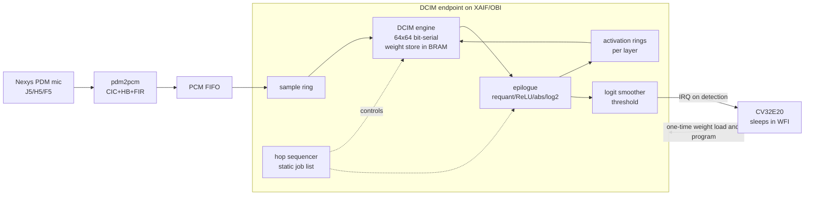

# Research direction discovery, round 5: an application-driven, feasible CIM × RISC-V contribution

Date: 2026-10-26 · Platform: X-HEEP `b3eb3c8` on Nexys A7-100T · Deadline: June 2027 (master's thesis)

Evidence labels:

| Label | Meaning |
|---|---|
| **[M]** | Measured in this round on the X-HEEP RTL (Verilator 5.040). Raw logs are in `evidence/`. |
| **[L]** | Local evidence from earlier project files (linked). |
| **[P]** | Stated by a published paper or documentation (linked); not reproduced here. |
| **[A]** | Explicit modelling assumption. |
| **[I]** | Inference from the items above. |
| **[H]** | Hypothesis or proposed method; no result is claimed. |

---

## 0. Summary

> **Update after the novelty review ([NOVELTY_ASSESSMENT.md](NOVELTY_ASSESSMENT.md)).** Seven overlapping papers already cover several of HopCIM's original pillars:
> - a learned or raw-audio front-end on the CIM (four papers);
> - streaming CIM;
> - an autonomous controller;
> - a RISC-V host.
>
> The recommended core claim is now the *model-preserving* front-end: the standard MFCC computed exactly on the digital CIM. A fixed-point screen gives ≈ 0.1 dB mean log-mel error with 8-bit factored-FFT coefficients. Streaming, the hop program and the MCU/FPGA demo remain as the system context. Sections 6–10 below are kept for traceability; where they disagree with the assessment, the assessment takes precedence.

**Recommendation.** The primary direction is **HopCIM**, a CPU-light always-on keyword-spotting pipeline on a RISC-V MCU with a bit-serial digital CIM. The CIM runs a learned audio front-end, a streaming DS-CNN and a fused epilogue as one per-hop program. Work is demonstrated on the Nexys A7 with its onboard PDM microphone. The backup is **FeedMatch**, a bandwidth-matched activation path for the same DCIM endpoint, applied to full-frame vision. Both share the first two months of hardware work.

**Why this choice is evidence-based rather than a guess.** I measured the CPU-side costs that remain around a CIM accelerator on the actual X-HEEP RTL [M]:

- An int8 MAC costs 11.5–18.8 cycles on CV32E20.
- A 512-point FFT plus mel/log/DCT costs **161k cycles per audio frame**.
- Requantisation costs 20–35 cycles per output.
- An SDK DMA call costs ~610–690 CPU cycles regardless of size.

Composing these with an explicit DCIM timing model [A] gives two results [I]:

1. **Always-on audio.** Once a DCIM executes the network, the CPU MFCC front-end is **78–92 % of the cycles in every 20 ms hop** (section 4.2). Moving the front-end and control onto the CIM cuts CPU-active cycles per hop by ~40–400× (depending on the baseline) and lowers the real-time clock from ~5–10 MHz to <0.5 MHz. These figures are modelled; the FPGA must confirm them.
2. **Full-frame vision and image classification.** Once requantisation is in hardware, **activation movement over the 32-bit SoC bus is 70–82 %** of DCIM-system time. **Weight reload is only 0–9 %.** This explains, after the fact, why the residency, reload and partial-sum mechanisms of earlier rounds had little end-to-end leverage on this platform.

**Contribution level, stated honestly.** HopCIM is a *system co-design and integration* contribution with a clear, measurable trade-off. It is not a new theory. Its closest prior work includes two NYCU systems: CIMR-V (ISCAS 2024) and Chiang–Chang–Jou (TVLSI 2022). The defensible differences:

- streaming, multi-bit bit-serial DCIM;
- the front-end placed on the shared CIM, with a capacity–accuracy–area comparison against a dedicated MFCC unit;
- CPU-light per-hop execution on an open RISC-V MCU;
- real-time operation measured with a live sensor.

This fits the brief's "new application/integration under a meaningful constraint". It does **not** depend on beating an optimal static residency baseline, which is where five earlier directions failed.

---

## 1. What changed in this round

The new brief accepts bounded scope and explicit trade-offs. It also asks for an application, a working demonstration and evidence about where a method helps. The selection rule used here:

1. **Measure first.** Find the binding cost of the *whole application* on the *actual platform*, with an accelerator present.
2. Pick a mechanism that removes that cost. State what it gives up (CIM capacity, area, flexibility, accuracy).
3. Evaluate against the strongest reasonable alternatives, including a dedicated-hardware alternative, over an operating range. Universal superiority is not required.

---

## 2. Previous directions, reconstructed

Sources: [N4R conclusion](../../recim-rv/docs/N4R_RESEARCH_CONCLUSION.md), [CIMYield record](../../recim-rv/reproduction_logs/20261025_cimyield_measured_backend_v1/RECORD.md), [RangePack decision](../../rangepack_pilot/docs/GATE_DECISION.md), [BankWeave decision](../../bankweave_pilot/docs/GATE_DECISION.md), [PlaneNest Gate 0](../../planenest/docs/GATE0_DECISION.md), and the discovery reports in `../`.

| Direction | Intended contribution | What was built | Result [L] | Failure type |
|---|---|---|---|---|
| ReCIM-RV / N4R | Residency/QoS scheduler on CIMFlow K4 | Scheduler, native traces, request runtime | Distinct ONNX orders changed **0/240 and 0/288** native cluster positions; fixed B8 batching was stronger | Action not executable in the backend; strong baseline captured the gain |
| CIMYield | Yield-point execution on a measured backend | C++ integer backend with owner/epoch checks | Exact, but slower than B1 in all 4 shapes | Failed hypothesis (overhead > benefit) |
| RangePack | Partial-sum range codec | Exact codec RTL + testbench | 1.000× against the strong tiling | Non-binding bottleneck |
| BankWeave | Bank-level programming/compute scheduling | Event engine + exhaustive oracle | 1.069× vs weak, **0.995×** vs strongest baseline | Strong baseline already at max(Σcomp, Σprog) |
| PlaneNest | Nested bit-plane residency | Nested QAT, sim_v2, board bring-up | Gate 0 failed: S1 0.845 (bytes) / 0.873 (cycles), S2 0.988 vs ≤ 0.75; KWS alone 0.349 | Broad hypothesis failed; benefit confined to a narrow capacity window |
| ExitAlign / ReloadSpec | Capacity-aligned exits; reload-time specialisation | Screening scripts | Headroom below threshold | Failed at screening |
| RetireTile | Activation-tile retirement | Proposal only | Activations were not the binding resource; close to DeFiNES/LoopTree/CIM-Tuner | Non-binding + insufficient novelty |
| TileProof / CIMRefine | Validation of CIM compiler output | CIMFlow probe; proposal | TileProof rejected (production value, framing); CIMRefine squeezed by BOLT and AccelSync | Goal mismatch / novelty collision |

**Cross-cutting diagnosis [I].** Every mechanism targeted a *CIM-internal* resource: residency, partial sums, banks, or the precision of resident weights. The census in section 4 uses measured X-HEEP costs. It shows that, end to end, those resources are small next to CPU-side work (front-end, requantisation, driver) and activation movement. Two factors combined: strong static baselines removed the remaining headroom, and the optimised resource was a minor share of total time.

**Reusable assets [L]:**

- one-cable board flow ([BOARD_BRINGUP.md](../../planenest/docs/BOARD_BRINGUP.md));
- `xheep_env.sh`, and Verilator 5.040 with the new trace opt-out (appendix A);
- `census_microbench`;
- the DCIM macro RTL [`pa_dcim_macro.sv`](../../planenest/hw/pa_dcim/rtl/pa_dcim_macro.sv), with per-column significance/sign descriptors;
- QAT modules in [`nested_qat_v2.py`](../../planenest/ml/nested_qat_v2.py): fake-quant, `ActQuant`, `SwitchBN`, GPU augmentation;
- the RangePack-style RTL testbench pattern;
- frozen-gate and manifest discipline.

CIMFlow is not on the critical path: its whole-network route runs in `no_real_data` mode.

**Assumptions to change:**

- Optimise the measured dominant cost, not an internal one.
- Evaluate per application unit (per hop, per frame), with the CPU included.
- Treat area and flexibility as explicit costs.
- Include a dedicated-hardware alternative as a baseline.

---

## 3. Platform facts

### 3.1 X-HEEP and the board

| Item | Status |
|---|---|
| Core / memory | CV32E20 (`RV32MFast` default), 4 × 32 KiB SRAM, code 58 KiB / data 70 KiB split [L: `configs/general.py`] |
| FPGA use, Nexys A7-100T | **32,569 / 63,400 LUT (51.4 %)**, 32,216 / 126,800 FF, **36 / 135 BRAM36**, **1 / 240 DSP** [M: `impl_1/..._utilization_placed.rpt`] |
| Timing | Routed WNS −7.857 ns over 64 failing endpoints, the SPI crossings noted in round 4. The core domain has positive slack at 15 MHz. Constrain or scope these before quoting timing [M] |
| Audio input | `hw/ip/pdm2pcm` exists (CIC + half-band + FIR, FIFO, `RXDATA` window). **It is not instantiated in `general.py`.** The Nexys constraints map it to 7-segment pins P15/T11. The onboard mic is on **J5 (M_CLK), H5 (M_DATA), F5 (M_LRSEL)** [M: repo; P: [Digilent master XDC](https://github.com/Digilent/digilent-xdc/blob/master/Nexys-A7-100T-Master.xdc)]. The bundled `example_pdm2pcm` says it tests an outdated version |
| SPI flash | Mapped to Pmod JA, not the onboard QSPI. Unusable without extra hardware [M: `pin_assign.xdc`] |
| Integration | XAIF/OBI slave and master ports, DMA with 2-D/strides/padding/multichannel/triggers, `im2col_spc` and `simple_accelerator` examples, CV-X-IF for coprocessors (a Quadrilatero config exists), power manager [L/M] |
| Arty A7 | If it is the **35T** variant (20,800 LUT, 50 BRAM36), this X-HEEP configuration (32.6k LUT) **does not fit**. A 100T Arty has the same device as the Nexys but no microphone. Use the Nexys for everything |

### 3.2 Framework roles

| Framework | Role here | Limit |
|---|---|---|
| X-HEEP | Host SoC, DMA, PDM path, FPGA flow — **adopt** | The endpoint, driver and hop program are new work |
| Verilator / Vivado | RTL tests, SoC simulation, utilisation, timing | FPGA cycles are real; FPGA power is not ASIC power |
| CiMLoop / AccelForge | Per-pass DCIM energy and per-KiB area for the *modelled* energy/area comparison | Use per-action costs only (the earlier K4 fidelity gate failed) |
| CIMFlow | Optional cross-check of pass counts | Whole-network route is `no_real_data`; not needed |
| PyTorch + MLPerf Tiny KWS scripts | Training, QAT, KD, export | The GPU is currently occupied by the PlaneNest H1 queue |
| Vivado FFT LogiCORE | Dedicated-front-end baseline (B3) | IP licence terms to be confirmed in your Vivado install |

---

## 4. Measured evidence: what remains after a CIM is added

### 4.1 CPU-side microbenchmarks on X-HEEP [M]

App: [`census_microbench/main.c`](../../planenest/hw/x-heep/sw/applications/census_microbench/main.c). Build: `-O2 -march=rv32imc`. Timing: `mcycle`, with the AO timer for DMA wall time. Log: `evidence/census_microbench_uart.log`.

| Kernel | Cycles |
|---|---:|
| int8 dot product, naive / word loads | 13.0 / 11.0 per MAC |
| conv 3×3, 16→16, 8×8 output (147,456 MACs) | **12.62 per MAC** |
| pointwise 64→64, 25×5 (512,000 MACs) | **11.53 per MAC** |
| depthwise 3×3, 64 channels, 25×5 (72,000 MACs) | **18.77 per MAC** |
| requantisation, multiply-shift-clamp / TFLM-exact rounding | 20.0 / 35.0 per output |
| CPU word copy | 2.25 per byte |
| DMA 4 KiB via SDK (wall) | 2,666 total (~2 B/cycle steady) |
| One SDK `dma_copy` call, CPU-active | 610–692 |
| MMIO write / read (loop) | 8.0 / 9.0 |
| FFT, 512-point complex Q15 | **145,142 per frame** |
| power + 40-band mel + log2 + 10-point DCT | **15,632 per frame** |

### 4.2 Always-on KWS, streaming DS-CNN, per 20 ms hop [M constants + A model]

Script: [`analysis/post_cim_census.py`](analysis/post_cim_census.py), output in `analysis/post_cim_census_output.txt`.

DCIM model [A]:

- 64-row × 64-output macro with 8-bit weights, bit-serial 8-bit inputs (8 cycles per pass);
- depthwise mapped block-diagonally, 7 channels per pass;
- im2col feeding at the measured 2 B/cycle;
- hardware epilogue at 1 output per cycle;
- no CPU/CIM overlap (conservative);
- 500 CPU cycles per hop to wake and decide.

Real time at 15 MHz is 300k cycles per hop.

| Scenario | Wall cycles / hop | CPU-active / hop | f_min for real time | Front-end share |
|---|---:|---:|---:|---:|
| S0 CPU only (streaming DS-CNN + MFCC) | 859,689 | 859,689 | 43.0 MHz | 18.7 % |
| S1 DCIM MVMs; CPU requant; SDK DMA per job; CPU MFCC | 205,092 | 197,752 | 10.3 MHz | **78.4 %** |
| S2 S1 + hardware epilogue | 175,584 | 168,952 | 8.8 MHz | **91.6 %** |
| S3 S2 + lean driver + real-input FFT | 104,088 | 97,456 | 5.2 MHz | **91.7 %** |
| S4 S3 with a learned filterbank on the DCIM | 9,568 | 2,268 | 0.48 MHz | 6.8 % |
| S5 S4 + autonomous hop program | 7,800 | 500 | 0.39 MHz | 8.4 % |

[I] Once the network runs on a DCIM, the per-hop budget is the front-end. The largest lever is moving the front-end off the CPU (S3 → S4: ~43× CPU-active). Autonomous sequencing adds ~4.5× on top of a lean driver. Against the SDK-driver baseline, the total is ~400×. A dedicated FFT/MFCC unit would also remove the front-end cost, at a dedicated-area price. That unit is therefore a required baseline (B3 in section 7).

### 4.3 Full inferences, weights in SRAM [M constants + A model]

Rows assume a hardware epilogue and a lean driver. With CPU requantisation and the SDK driver, the CPU share is 77–81 % instead.

| Model | Weights | CPU only | DCIM system | Reload | Compute | Feed | Output | CPU |
|---|---:|---:|---:|---:|---:|---:|---:|---:|
| KWS DS-CNN, 1 s window (64 KiB CIM, resident) | 21.5 KiB | 34.5 Mcyc | 328 kcyc (105×) | 0 % | 13.7 % | **49.5 %** | **32.9 %** | 3.8 % |
| IC ResNet-8 | 75.5 KiB | 159.2 Mcyc | 507 kcyc (314×) | 7.6 % | 16.5 % | **48.8 %** | **25.4 %** | 1.7 % |
| VWW MobileNetV1-0.25 | 203.2 KiB | 97.3 Mcyc | 1,192 kcyc (82×) | 8.7 % | 15.3 % | **41.3 %** | **29.1 %** | 5.5 % |

[I] For frame-based inference, the binding resource is activation movement: im2col replication plus output writes over a 2–4 B/cycle bus. A bit-serial 64-row macro consumes 8 B/cycle at full rate. This motivates the backup (FeedMatch).

**Limits of this evidence.** The DCIM side is a model, not hardware. Layer shapes follow the round-4 MLPerf Tiny approximations. Overlap would reduce wall time but not change which term dominates. The FPGA board has not yet re-measured the CPU constants; that is step 1 in section 10.

---

## 5. Applications considered

| Application | Device / workload | Bottleneck with a DCIM present | Constraint that makes it interesting | Assessment |
|---|---|---|---|---|
| **Always-on KWS** (wake word, commands) | Battery-powered RISC-V MCU, 16 kHz audio, DS-CNN, 20 ms hops | CPU front-end (78–92 % of hop cycles) and per-job control [M+A] | Hard real-time hops; the CPU should sleep; only the Nexys mic gives a real sensor-in-the-loop demo | **Primary (C1)** |
| Visual wake words / person detection | Same MCU, 96×96 frames at 1–10 fps | Activation movement 70–82 %; reload ≤ 9 % [M+A] | 128–256 KiB SRAM; no camera on the board (images replayed) | **Backup (C2)** |
| Human activity recognition (onboard ADXL362) | Tiny 1D CNNs (0.05–23 kB) [P: [Daghero et al.](https://arxiv.org/abs/2209.00839)] | The CPU already keeps up | CIM not needed for latency | Not selected |
| Machine-sound anomaly detection | FC autoencoder, 258 KiB | Does not fit 128 KiB; FC layers have no reuse | Needs a larger SRAM configuration | Not selected |
| Batteryless sensing | Intermittent power, SRAM-DCIM | Weight reprogramming after every outage | Energy evaluation would be modelled only | Candidate C4 (not top two) |

---

## 6. Candidate directions

Each candidate lists problem and scope, method, implementation, evaluation, feasibility and research value. Names are working labels only; none is claimed as a contribution.

### C1. HopCIM — CPU-light always-on KWS with the whole per-hop pipeline on one DCIM

- **Problem / scope.** Always-on KWS on an MCU-class RISC-V with a bit-serial DCIM, using streaming inference at 20 ms hops. After DCIM acceleration, per-hop work is 104–205k cycles, almost all of it CPU front-end and control (section 4.2). Assumptions: GSC 12-class; int8 weights; 16-bit PCM input; the model fits a 48–64 KiB DCIM.
- **Method.**
  1. A learned 1-D filterbank on PCM (e.g., 40 filters × 480 taps, stride = hop), run as a 16-bit bit-serial MVM on the DCIM. The epilogue applies |·| plus a leading-one/LUT log2. Training uses knowledge distillation from an MFCC teacher.
  2. A causal, streaming DS-CNN with per-layer ring buffers and modular addressing.
  3. A compiler-generated static hop program executed by a small sequencer. The trigger is a PDM-FIFO threshold or timer; the CPU is interrupted only on detection.
  4. A capacity split: choose front-end size (filters, taps, input bits) and back-end width to maximise accuracy under (CIM capacity, passes per hop).
  - **Differs from prior work:** streaming, multi-bit bit-serial DCIM, a CPU-light hop program, and a measured comparison against a dedicated MFCC unit. See 8.10.
- **Implementation.** DCIM endpoint RTL: macro engine, weight store, activation rings, epilogue, sequencer. X-HEEP integration via XAIF/OBI. The PDM path uses `pdm2pcm` plus pin remapping. Firmware and exporter. QAT/KD training. Minimum implementation: a Verilator SoC run of one hop program, bit-exact against a NumPy integer reference.
- **Evaluation.** Baselines B0–B4 (section 7), accuracy on GSC, streaming FAR/FRR, per-hop cycles, CPU-active cycles, f_min, LUT/BRAM/DSP, and modelled energy. Live demo with the onboard microphone.
- **Feasibility.** Medium-high. Every block is standard digital design.
  - **Main risks:** the outdated `pdm2pcm` example; learned-front-end accuracy; the GPU is occupied.
  - **First experiment:** the front-end gate in 10.2.
  - **Fallback:** keep MFCC and compare CPU against a dedicated FFT unit. The front-end placement study still stands.
- **Research value.** System co-design with an explicit trade-off.
  - **Closest prior work:** CIMR-V (raw-audio binary conv in CIM, CPU-issued CIM instructions) [P: [arXiv 2503.22072](https://arxiv.org/abs/2503.22072)]; Chiang–Chang–Jou TVLSI 2022 (IMC KWS with on-chip learning) [P: [arXiv 2205.04665](https://arxiv.org/abs/2205.04665)]; Song et al. 2022, KD raw-waveform encoder for IMC, algorithm only [P: [Interspeech](https://www.isca-archive.org/interspeech_2022/song22c_interspeech.html)]; streaming KWS (Rybakov et al.) [P: [arXiv 2005.06720](https://arxiv.org/abs/2005.06720)]; the configuration wall [P: [arXiv 2511.10397](https://arxiv.org/abs/2511.10397)].
  - **Remaining novelty uncertainty:** the full texts of CIMR-V and Kang et al. ASP-DAC 2025 (RISC-V + eFlash-CIM KWS) [P: [DGIST record](https://scholar.dgist.ac.kr/handle/20.500.11750/58411)] must be read before claiming "first streaming / CPU-light".
  - **Publication evidence needed:** measured CPU-active reduction ≥ 20× vs S3, accuracy within 1 pp, and an honest area/capacity comparison against B3.

### C2. FeedMatch — bandwidth-matched activation movement for an MCU DCIM endpoint (vision)

- **Problem / scope.** Full-frame vision (VWW 96×96, IC ResNet-8) on X-HEEP. With the epilogue in hardware, input feed plus output write is 70–82 % of DCIM-system time. A bit-serial macro needs ~8 B/cycle; the bus provides 2–4.
- **Method.**
  1. A sliding-window line buffer and window generator in the endpoint, removing im2col replication.
  2. Input broadcast across resident output-channel tiles, versus weight-stationary re-feed, chosen per layer by an analytical cost model under the CIM capacity.
  3. Optional plane-major activation storage with per-block precision tags, so the feeder fetches and serialises only non-zero bit planes. This is exact: skipping all-zero planes changes no value.
  4. A fused epilogue covering residual add and pooling.
- **Implementation.** Same endpoint as C1, with a different feeder. Images replayed over UART.
- **Evaluation.** Baselines: CPU only; DCIM + X-HEEP `im2col_spc`/DMA; + line buffer; + broadcast; + plane-major. Metrics: bytes moved, cycles, CIM utilisation, buffer KiB, LUT/BRAM. Operating range swept over line-buffer size, CIM capacity and bus width.
- **Feasibility.** High (shares C1's endpoint).
  - **Main risk:** limited novelty.
  - **First experiment:** per-layer traffic model plus activation plane statistics from trained int8 models.
- **Research value.** Low–moderate. Line buffers and dataflow choice are classic (Eyeriss-style). Closest: CIMR-V input shift buffer and layer fusion; AccelCIM [P: [arXiv 2604.17692](https://arxiv.org/abs/2604.17692)]; CIM-Tuner [P: [arXiv 2601.18070](https://arxiv.org/abs/2601.18070)]; dynamic-precision bit-serial engines (Loom, Pragmatic); Neural Cache's transposed layout. The defensible part is the MCU bus-bound regime, plane-major exact skipping, and measured operating ranges.

### C3. RowFill — CIM-geometry-aware model co-design

- **Problem.** DCIM latency depends on *passes* (ceil(K/R) · ceil(N/C) · P · bits), not on MACs. Block-diagonal depthwise layers use 9 of 64 rows per channel.
- **Method.** Replace depthwise 3×3 with grouped convolution, g = ⌊R/9⌋ = 7 channels per group. This costs the *same number of passes* while adding parameters. Quantise widths to the macro geometry.
- **Evaluation.** Accuracy at equal passes on KWS/VWW/IC.
- **Value.** Small alone; TetrisG-SDK [P: [arXiv 2604.25377](https://arxiv.org/abs/2604.25377)] and NAX/CIMNAS search similar spaces. **Fold into C1/C2 as an ablation.**

### C4. ReloadSafe — intermittent-power inference on SRAM-DCIM

- **Problem.** In batteryless nodes, every outage erases the CIM weights. The reprogramming tax per power cycle can exceed the energy budget when capacitors are small.
- **Method.** Energy-aware residency per power cycle, tile ordering for forward progress, and NVM footprints.
- **Evaluation.** Reset-injection emulation on the FPGA (exactness, reload bytes, completed work), with energy modelled from harvesting traces.
- **Value.** Moderate novelty: no SRAM-CIM intermittent paper was found. Close prior: Caronti et al. on MAX78000 checkpointing [P: [TECS 2023](https://iris.unitn.it/retrieve/bd6d637a-1703-4d1a-8b2b-2fece4c126e7/FINAL_ACM_TECS___Fine_grained_Hardware_Acceleration_for_Efficient_Batteryless_Intermittent_Inference_on_the_Edge.pdf)], ResiRCA [P: [NSF PAR](https://par.nsf.gov/biblio/10193309)], MOUSE, SONIC. Niche application; energy claims modelled only. **Higher-novelty alternative backup.**

### C5. StationaryTile — RISC-V matrix ISA executed on a DCIM

- **Problem / method.** Standard matrix-ISA code (Quadrilatero RVM) reloads tiles per instruction. Proposed: tag-matched stationary B tiles plus instruction coalescing.
- **Blocker.** The main benefit is energy, which the FPGA cannot show. Per-instruction cycles are likely *worse* than Quadrilatero's systolic array. Close prior: AME-PIM [P: [arXiv 2604.27808](https://arxiv.org/abs/2604.27808)]; DIMC inside the RVV pipeline [P: [arXiv 2602.01827](https://arxiv.org/abs/2602.01827)].

### C6. HopBatch — latency-bounded streaming when the model exceeds the CIM

- **Problem / method.** Process b hops per weight load, per layer (multi-rate), together with residency, under a detection-latency bound.
- **Blocker.** Fixed batching captured the gains in N4R. KWS-class models fit the CIM. Keep only as an operating-range sweep inside C1.

### C7. EnrollCIM — on-device keyword enrollment with CIM-resident prototypes

- **Problem / method.** User-defined wake words: write enrolled embeddings as CIM columns and match by MVM.
- **Blocker.** Close prior: Chiang–Chang–Jou TVLSI 2022 (on-chip customization, NYCU); Rusci & Tuytelaars [P: [Interspeech 2023](https://www.isca-archive.org/interspeech_2023/rusci23_interspeech.html)]. Possible demo extension of C1 only.

### C8. FlashStream — compressed weight streaming for models larger than SRAM

- **Problem / method.** Decode bit-plane or sign-extension packing on the CIM write path.
- **Blockers.**
  - No flash is reachable without a Pmod; the onboard QSPI needs STARTUPE2 rework, and the SPI paths fail timing.
  - Lossless int8 headroom is ~1.1–1.4× [I]: a Gaussian int8 weight has ~7 bits of entropy.
  - Reload is ≤ 9 % in the SRAM case anyway.

---

## 7. Ranking

Weights from the brief: relevance 15 %, contribution/novelty 20 %, feasibility 20 %, evaluation 15 %, reuse 10 %, publication 10 %, artifact 10 %. Score = Σ(w·s)/5 × 100. Reproducible in `candidate_scores.json`.

| # | Candidate | Rel | Contr | Feas | Eval | Reuse | Pub | Artif | **Score** | Blocker |
|---|---|---:|---:|---:|---:|---:|---:|---:|---:|---|
| 1 | **C1 HopCIM** | 4.5 | 3 | 4 | 4.5 | 4 | 3 | 4.5 | **78.0** | — |
| 2 | **C2 FeedMatch** | 4 | 2.5 | 4 | 4 | 4 | 2.5 | 3.5 | **70.0** | Novelty weak (engineering-leaning) |
| 3 | C3 RowFill | 3.5 | 2.5 | 4.5 | 3.5 | 3.5 | 2.5 | 2 | 65.0 | Too small alone → ablation |
| 4 | C7 EnrollCIM | 4 | 2 | 3.5 | 3.5 | 3.5 | 2 | 4 | 63.5 | Close NYCU prior |
| 5 | C4 ReloadSafe | 3 | 3.5 | 3 | 3 | 3 | 3.5 | 3 | 63.0 | — (niche; modelled energy) |
| 6 | C6 HopBatch | 3 | 2 | 4 | 3.5 | 4.5 | 2 | 2.5 | 61.5 | Fixed batching likely suffices |
| 7 | C5 StationaryTile | 3 | 3 | 2.5 | 2 | 3.5 | 3 | 3.5 | 57.0 | **FPGA cannot show the benefit** |
| 8 | C8 FlashStream | 3.5 | 2 | 2.5 | 3 | 3.5 | 2 | 3 | 54.5 | **No flash hardware; low headroom** |

**Balance.** C1 is the only candidate where (a) the binding cost is measured on your platform, (b) the mechanism removes most of it, (c) the FPGA can measure the result directly (cycles, CPU-active time, real time), and (d) a live demo exists. Its novelty score of 3 is the main weakness. Precise positioning against CIMR-V/TVLSI 2022 and a dedicated-MFCC baseline is therefore mandatory. C4 has more novelty but weaker evidence; it is the alternative if you want a riskier second option.

---

## 8. Primary proposal — HopCIM

### 8.1 Title, application, problem

*Working title:* "Mic-to-decision on one digital CIM: CPU-light always-on keyword spotting on an open RISC-V microcontroller."

*Application:* an always-on wake word or command set on a battery-powered sensor or wearable, 16 kHz audio, 20 ms hops.

*Problem:* on X-HEEP, streaming DS-CNN needs ~0.86 M CPU cycles per hop (43 MHz for real time). A DCIM shrinks the network to a few thousand cycles. The CPU still spends ~100–200k cycles per hop on the MFCC front-end, requantisation and per-job driver code, so it stays active 30–65 % of the time at 15 MHz [M+A].

### 8.2 Assumptions and scope

- One model family (DS-CNN, MLPerf Tiny KWS, GSC v2 12-class) plus one learned front-end family.
- int8 weights and activations; 16-bit PCM input (8-bit companded input is an ablation).
- The DCIM is digital and emulated on the FPGA. Cycle-faithful for a 64×64 macro (section 8.7); energy and area modelled only.
- Weights fully resident in a 48–64 KiB DCIM (~21.5 KiB back-end + 16–19 KiB front-end). Smaller capacities are an operating-range sweep (C6 folded in).
- Single model, single stream; no multi-tenancy.

### 8.3 Research question and hypotheses

**RQ.** Can the complete per-hop pipeline (front-end, streaming network, epilogue, control) run on the DCIM subsystem with near-zero CPU work, within 1 pp of MFCC accuracy? What does it cost in CIM capacity, FPGA area and flexibility, compared with a CPU front-end and with a dedicated FFT/MFCC unit?

| ID | Hypothesis [H] | Falsified if |
|---|---|---|
| H1 | With DCIM MVMs and a hardware epilogue, the CPU front-end is ≥ 70 % of per-hop cycles (board-measured) | < 50 % |
| H2 | A CIM-mappable learned front-end with streaming DS-CNN is within **1.0 pp** of MFCC + DS-CNN (int8 QAT, GSC-12), using ≤ 2× the back-end's CIM weights | > 2 pp, or > 3× weights |
| H3 | Per-hop CPU-active cycles fall ≥ 20× vs S3, and f_min for real time falls below 1 MHz, measured on the Nexys A7 with live audio | < 5×, or f_min ≥ 2 MHz |
| H4 | The added endpoint logic (sequencer, epilogue nonlinearity, ring address generation) is ≤ 15 % of X-HEEP LUTs and ≤ the LUT+DSP cost of the dedicated FFT/MFCC baseline | > 25 % of X-HEEP LUTs |

Thresholds are provisional. Freeze them in a manifest before the first held-out run.

### 8.4 Architecture



### 8.5 Hop program and sequencer

```text
job := { wbase, K, N, in_bits, rate,                       # rate: run every `rate` hops (time stride)
         src  = ring(base, len, row_bytes, taps, dilation),
         dst  = ring(base, len, row_bytes),
         epi  = (mult, shift, zp, act ∈ {relu, abs_log2, none}, pool ∈ {none, running_mean}) }

on hop_trigger(h):                                          # PCM FIFO >= 320 samples, or timer
  for job in program where h % job.rate == 0:
    for p in job.positions:                                 # e.g. 5 frequency positions per time row
      x = gather(job.src, head - taps .. head, p)           # modular addressing, no CPU
      acc = 0
      for rb in 0 .. ceil(K/R)-1:
        for b in MSB .. LSB of job.in_bits:                 # bit-serial passes
          acc += (macro_pass(job.wbase, rb, plane_b(x)) << b)   # MSB plane is subtracted (two's complement)
      job.dst[head][p] = epilogue(acc, job.epi)
    advance(job.dst.head)
  s = smooth(logits ring); if s > θ for k hops: raise IRQ
```

**Capacity-split co-design (offline).**

```text
maximise  acc(F, T, b_in, W_backend, g)
s.t.      w_front(F, T) + w_back(W_backend, g) <= C_cim
          passes_per_hop(F, T, b_in, W_backend, g) <= P_budget
```

Solved by a small grid on the GPU: F ∈ {16, 24, 40}, T ∈ {256, 400, 480}, b_in ∈ {8, 16}, g ∈ {1, 7}.

### 8.6 Artifacts, reuse, modifications

| Artifact | Reuse | New work |
|---|---|---|
| DCIM endpoint RTL | `pa_dcim_macro.sv` descriptors; RangePack testbench style; `simple_accelerator`/XAIF template | Engine, weight store, rings, epilogue (requant, ReLU, abs, log2 LUT), sequencer, register map (reggen) |
| SoC configuration | `configs/general.py` | Add `PDM2PCM(0x00060000)` and the endpoint; remap mic pins; constrain the endpoint clock domain |
| Firmware | X-HEEP SDK, `census_microbench` | Loader, hop-program writer, detection handler, cycle logging |
| Model | MLPerf Tiny KWS scripts; QAT modules from `nested_qat_v2.py` | Causal streaming DS-CNN, learned front-end + KD, integer export, NumPy integer reference |
| Baseline B3 | Vivado FFT LogiCORE | Mel/log/DCT unit; same XAIF wrapper |

### 8.7 Baselines, metrics, trade-offs

| ID | Baseline |
|---|---|
| B0 | CPU only, streaming int8 kernels (measured X-HEEP code path) |
| B1 | DCIM MVMs, CPU requant, SDK DMA per job, CPU MFCC (complex FFT) |
| B2 | B1 + hardware epilogue + lean driver + CPU real-FFT MFCC (strong software baseline) |
| **B3** | B2 + **dedicated FFT/mel/log/DCT hardware** (strong hardware baseline) |
| B4 | Non-streaming 1 s window recomputed every k hops, on the DCIM |
| HopCIM | Learned front-end on the DCIM + streaming + hop sequencer |

**Ablations:** front-end on CPU vs CIM vs B3; streaming vs window; sequencer vs lean driver; depthwise vs row-filled grouped conv (C3); 16- vs 8-bit audio input; filterbank size; CIM capacity sweep 16–64 KiB (C6).

**Metrics and sources:**

| Metric | Source |
|---|---|
| Per-hop wall cycles, CPU-active cycles, f_min | Board counters (mcycle with WFI, AO timer) |
| Detection latency | Board |
| Accuracy | GSC test set, PyTorch integer model, with board bit-exactness on a replayed subset over UART |
| FAR per hour / FRR | Long concatenated noisy streams |
| LUT/FF/BRAM/DSP, WNS | Vivado |
| CIM KiB used | Exporter |
| Energy per hop | Modelled: CPU active time + DCIM per-pass energy (AccelForge/CiMLoop) + SRAM access counts; labelled as such |

**Expected trade-offs:** CIM capacity (~16–19 KiB for the front-end) and possible accuracy loss in exchange for removing CPU front-end work and dedicated front-end hardware. Flexibility (a static hop program) in exchange for CPU sleep time.

### 8.8 FPGA prototype plan

- X-HEEP at 15 MHz.
- Endpoint datapath at 4× clock: **128 DSP48** (of 239 free) compute a 64×64 pass in ≤ 8 SoC cycles. This keeps the bit-serial timing model cycle-faithful.
- Weights in BRAM: 12–16 BRAM36 of 99 free.
- Endpoint LUT target ≤ 10k of ~30.8k free.
- `pdm2pcm` enabled; mic pins J5/H5/F5; M_LRSEL tied to a fixed level.
- LEDs show detection; UART logs counters.
- Exactness check: board output = NumPy integer reference for every replayed clip.
- Timing: constrain the new domain and the CDC; keep the existing SPI violations out of scope (unused) and document them.

### 8.9 Risks and fallbacks

| Risk | Likelihood | Fallback |
|---|---|---|
| `pdm2pcm` example outdated or IP misbehaves | Medium | Own ~200-line CIC decimator; or replay PCM over UART (the research result is unaffected; only the live demo weakens) |
| Learned front-end loses > 1 pp | Medium | Report the accuracy–capacity frontier honestly; keep the B3 path; the paper becomes "where to place the front-end on a CIM MCU" |
| Domain shift between the board mic and GSC | Medium | Report GSC numbers as primary; live demo is qualitative; optional few-shot fine-tuning (C7) |
| GPU unavailable | Now | Stop the H1 queue (your decision) |
| Novelty challenged by CIMR-V/TVLSI 2022 | Medium | Read both full texts first (section 10); centre the claim on streaming, CPU-light operation, multi-bit DCIM and the B3 comparison |
| FPGA timing or resources | Low–medium | Reduce to 32×64; use a 2× clock; time-multiplex with virtual time and document it |

### 8.10 Contribution, limitations, novelty boundary

**Expected contributions:**

1. Measured evidence that a DCIM moves the always-on bottleneck to the CPU front-end and control on an MCU-class RISC-V.
2. A CIM-native front-end and capacity-split co-design for multi-bit bit-serial DCIM.
3. CPU-light streaming execution with measured real-time operation and a live sensor.
4. An open X-HEEP DCIM endpoint.

**Limitations:** one model family; FPGA timing is cycle-faithful but energy and area are modelled; digital DCIM only; 15 MHz host.

**Novelty boundary.** The hardware pieces are standard: sequencer, ring buffers, epilogue. The new claim is the measured trade-off and the co-design.

| Work | Overlap |
|---|---|
| Commercial always-on voice chips with hardware front-ends | The idea of a CPU-free audio pipeline |
| CIMR-V | Raw-audio conv on CIM, with a RISC-V host |
| Song et al. 2022 | KD raw-waveform encoder for IMC |

### 8.11 Milestones (to June 2027)

| When | Milestone |
|---|---|
| Nov 2026 (2 weeks) | **Gate A**: steps 1–3 in section 10 → continue or switch to the backup |
| Dec 2026 – Jan 2027 | Endpoint RTL + unit tests; Verilator SoC integration; first hop program bit-exact |
| Feb 2027 | FPGA integration; live mic; B0–B2 measured |
| Mar 2027 | B3 (dedicated FFT) and ablations; capacity sweep |
| Apr 2027 | Streaming FAR/FRR; energy model; freeze results |
| May 2027 | Thesis and paper |
| Jun 2027 | Buffer and defense |

### 8.12 Paper outline

1. Introduction: always-on KWS; a CIM accelerates MVMs, yet the MCU stays busy.
2. Motivation: post-CIM census on X-HEEP (measured).
3. Design: CIM-native front-end, streaming mapping, hop program, capacity split.
4. Implementation: X-HEEP endpoint, PDM path, toolflow.
5. Evaluation: accuracy; per-hop cycles; CPU-active time; f_min; area; vs dedicated MFCC; ablations; operating ranges.
6. Related work: CIMR-V, TVLSI 2022, IMC KWS, streaming KWS, configuration overhead, learned front-ends.
7. Limitations and conclusion.

---

## 9. Backup proposal — FeedMatch

**Title.** "Bandwidth-matched activation movement for a bit-serial DCIM in an MCU-class RISC-V SoC."

**Application.** Visual wake words / person detection at 1–10 fps, plus image classification, on X-HEEP with 128–256 KiB SRAM.

**Problem [M+A].** Feed plus output is 70–82 % of DCIM-system time; weight reload is ≤ 9 %. The bit-serial macro needs ~8 B/cycle; the bus gives 2–4.

**RQ / hypothesis [H].** A line-buffer feeder, capacity-aware input broadcast and exact plane skipping together cut bus bytes per inference by ≥ 3× and cycles by ≥ 2× vs DMA-im2col feeding, at ≤ 16 KiB of local buffer. Falsified if the gains are < 1.5× after tuning the strong baseline.

**Method:**

```text
for layer in network:
  choose order ∈ {weight-stationary/re-feed, input-broadcast/all-N-tiles-resident}
         by cost(bytes_bus, buffer, CIM capacity)      # analytical, exhaustive per layer
  stream input rows once into the line buffer; form k×k windows locally
  (optional) read only planes ≤ block_max_plane from plane-major storage
  epilogue writes int8 (or plane-major + tag) outputs; fuse residual/pool
```

**Artifacts and reuse.** C1's endpoint (engine, epilogue, sequencer) plus a different feeder. X-HEEP `im2col_spc` as a baseline. Images replayed over UART.

**Baselines.** CPU only; DCIM + DMA im2col; + line buffer; + broadcast; + plane-major.

**Metrics.** Bus bytes, cycles, utilisation, buffer KiB, LUT/BRAM, plane statistics. Accuracy is unchanged: every mode is exact.

**Minimum experiment.** Per-layer byte model for IC/VWW, plus per-64-block activation plane statistics from trained int8 models (GPU).

**Risks.** Low novelty (classic dataflow; AccelCIM, CIM-Tuner, CIMR-V). Mitigation: emphasise the bus-bound MCU regime, exact plane skipping, and measured operating ranges.

**Milestones.** Same as C1 until Feb 2027; then feeder RTL (Feb), evaluation (Mar–Apr).

**Paper.** Short-paper scale (ISCAS/AICAS/ESL).

**Higher-novelty alternative.** C4 ReloadSafe reuses the same endpoint plus reset-injection emulation. Its energy results would be modelled only.

---

## 10. Final recommendation and first steps

### 10.1 Answers to the brief's questions

- **Problem.** Always-on streaming KWS on an MCU-class RISC-V with a DCIM keeps the CPU busy. The front-end and per-job control are 78–92 % of per-hop cycles once the network is on the CIM [M+A].
- **Why it matters.** Always-on KWS is the canonical battery-powered TinyML workload. A CPU awake 30–65 % of the time defeats the purpose of an efficient accelerator.
- **Method.** A CIM-native learned front-end, streaming DS-CNN mapping, and a static per-hop program on a small sequencer, with a capacity-split co-design.
- **Artifact.** An open X-HEEP DCIM endpoint with PDM path, exporter and integer reference, plus a live Nexys demo.
- **Assumptions that keep it manageable.** Digital DCIM; resident weights; one model family; 15 MHz host; energy modelled.
- **Trade-offs.** CIM capacity, possible accuracy loss and reduced flexibility, in exchange for CPU sleep time, a lower clock, and no dedicated front-end hardware.
- **Why it is different enough.** Streaming, multi-bit bit-serial DCIM, CPU-light per-hop execution, a measured live system, and an explicit comparison with a dedicated MFCC unit (section 8.10). Two full texts must be checked first.
- **Evaluation.** B0–B4, ablations and operating ranges (section 8.7).
- **What the infrastructure contributes:**
  - X-HEEP: host, DMA, PDM IP, FPGA flow.
  - CiMLoop/AccelForge: modelled energy and area.
  - CIMFlow: not required.
- **FPGA role.** Cycle-faithful DCIM timing, real CPU-active cycles and real-time operation with live audio. No energy claims from FPGA power.
- **What supports or invalidates it.** H1–H4 in section 8.3.
- **Realistic contribution if gains are modest.** A measured, open characterisation of where the always-on front-end should live on a CIM MCU (CPU, dedicated unit or CIM), with a working demo. That is a solid master's thesis and an ISCAS/AICAS/ESL-class paper.

### 10.2 First three implementation steps

1. **Re-measure the census on the board.** Build `census_microbench` for `TARGET=nexys-a7-100t` and run it through the one-cable flow. Confirm that the board and Verilator agree on the [M] constants. Add a real-input FFT variant.
2. **Bring up the PDM microphone.**
   - Copy `configs/general.py` to `configs/kws_nexys.py` and add `PDM2PCM(0x00060000)`.
   - Run `make mcu-gen`.
   - In `pin_assign.xdc`, map `pdm2pcm_clk_io` → J5 and `pdm2pcm_pdm_io` → H5, and tie M_LRSEL (F5).
   - Rebuild the bitstream.
   - Record 1 s of audio into SRAM, dump it over UART, and check a tone and a spoken word on the host.
3. **Train the baselines** (needs the GPU). MFCC + causal DS-CNN with int8 QAT, and 2–3 learned-front-end variants with KD. Export integer models and pass/capacity tables.

### 10.3 First experiment: "front-end gate" (before any RTL)

Frozen pass rules, written into a manifest first:

- **(a) H1:** with board-measured constants, the CPU front-end is ≥ 70 % of S2/S3 per-hop cycles.
- **(b) H2:** the learned front-end is within 1.0 pp of MFCC at ≤ 2× back-end weights.
- **(c) Novelty:** the full texts of CIMR-V (arXiv 2503.22072) and TVLSI 2022 do **not** already report streaming, CPU-light, multi-bit operation.

| Outcome | Action |
|---|---|
| (a) and (c) pass | Start the endpoint RTL in December |
| (b) fails | Proceed with front-end placement (CPU vs dedicated unit vs CIM) as the thesis question |
| (a) or (c) fails | Switch to FeedMatch, or to C4 if you prefer higher novelty |

---

## 11. References

**Platform**

- X-HEEP: [repository](https://github.com/x-heep/x-heep); [TinyAI platform paper](https://arxiv.org/abs/2508.16959); [original paper](https://arxiv.org/abs/2401.05548)
- NM-Caesar / NM-Carus: [arXiv 2406.14263](https://arxiv.org/abs/2406.14263)
- Digilent Nexys A7 master XDC: [GitHub](https://github.com/Digilent/digilent-xdc/blob/master/Nexys-A7-100T-Master.xdc)

**KWS and CIM**

- CIMR-V: [arXiv 2503.22072](https://arxiv.org/abs/2503.22072)
- Chiang, Chang, Jou, TVLSI 2022: [arXiv 2205.04665](https://arxiv.org/abs/2205.04665)
- Song et al., Interspeech 2022: [ISCA archive](https://www.isca-archive.org/interspeech_2022/song22c_interspeech.html)
- Rybakov et al., streaming KWS: [arXiv 2005.06720](https://arxiv.org/abs/2005.06720)
- Hello Edge: [arXiv 1711.07128](https://arxiv.org/abs/1711.07128)
- MLPerf Tiny: [repository](https://github.com/mlcommons/tiny)
- KeyRAM: [JSSC PDF](https://hassandbouk.web.illinois.edu/data/ram-jssc.pdf)
- Kang et al., ASP-DAC 2025: [DGIST record](https://scholar.dgist.ac.kr/handle/20.500.11750/58411)
- KWS audio SoC on FPGA: [arXiv 2509.06964](https://arxiv.org/abs/2509.06964)
- Rusci & Tuytelaars: [Interspeech 2023](https://www.isca-archive.org/interspeech_2023/rusci23_interspeech.html)
- Ethos-U KWS use case: [docs](https://git.mlplatform.org/ml/ethos-u/ml-embedded-evaluation-kit.git/tree/docs/use_cases/kws.md?h=21.03)

**Control, dataflow, mapping**

- The Configuration Wall: [arXiv 2511.10397](https://arxiv.org/abs/2511.10397)
- AccelCIM: [arXiv 2604.17692](https://arxiv.org/abs/2604.17692)
- CIM-Tuner: [arXiv 2601.18070](https://arxiv.org/abs/2601.18070)
- TetrisG-SDK: [arXiv 2604.25377](https://arxiv.org/abs/2604.25377)
- Minimal-buffer-traffic depthwise dataflow: [arXiv 2508.14375](https://arxiv.org/abs/2508.14375)
- NAX: [arXiv 2106.12125](https://arxiv.org/abs/2106.12125)

**RISC-V matrix / vector with CIM or PIM**

- AME-PIM: [arXiv 2604.27808](https://arxiv.org/abs/2604.27808)
- DIMC in the RVV pipeline: [arXiv 2602.01827](https://arxiv.org/abs/2602.01827)
- Quadrilatero: [arXiv 2504.07565](https://arxiv.org/abs/2504.07565)

**Intermittent computing**

- Caronti et al., TECS 2023: [PDF](https://iris.unitn.it/retrieve/bd6d637a-1703-4d1a-8b2b-2fece4c126e7/FINAL_ACM_TECS___Fine_grained_Hardware_Acceleration_for_Efficient_Batteryless_Intermittent_Inference_on_the_Edge.pdf)
- ResiRCA: [NSF PAR](https://par.nsf.gov/biblio/10193309)
- SONIC: [SysML PDF](https://mlsys.org/Conferences/2019/doc/2018/110.pdf)
- Checkpoint-free intermittent inference: [arXiv 2503.06663](https://arxiv.org/abs/2503.06663)

**Temporal redundancy**

- DeltaCNN: [CVPR 2022](https://openaccess.thecvf.com/content/CVPR2022/papers/Parger_DeltaCNN_End-to-End_CNN_Inference_of_Sparse_Frame_Differences_in_Videos_CVPR_2022_paper.pdf)
- Deltoris: [arXiv 2608.04428](https://arxiv.org/abs/2608.04428)

**Local**

- Round-4 headroom: [tiny_headroom_output.txt](../20261025_round4_elastic_residency/analysis/tiny_headroom_output.txt)
- [PlaneNest Gate 0 decision](../../planenest/docs/GATE0_DECISION.md)
- [Board bring-up record](../../planenest/docs/BOARD_BRINGUP.md)

---

## Appendix A. Changes made in this round

| Path | Change | Reversible |
|---|---|---|
| `planenest/hw/x-heep/sw/applications/census_microbench/{main.c,tables.h}` | **New** microbenchmark app | Delete the folder |
| `planenest/hw/x-heep/tb/tb_top.cpp` | Waveform dumping skipped when `XHEEP_NO_TRACE=1`; default behaviour unchanged. Patch in `evidence/tb_top_no_trace.patch` | `git checkout tb/tb_top.cpp` |
| `.../sim-verilator/Vtestharness` | Relinked with the patched testbench (RTL model unchanged) | Rebuild |
| `research_discovery/20261026_application_driven/` | **New**: this report, analysis script and output, scores, evidence | — |

The same 1.10 M-cycle program took 46 min with waveform dumping and 34 s without it (~80×). The final 10.6 M-cycle run used the untraced path. SHA-256 values for the ELF and testbench binary are in `evidence/SHA256SUMS`.
